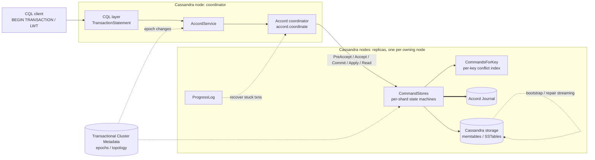

# System Brief: Apache Cassandra Accord

**Target:** Accord — https://github.com/apache/cassandra-accord (library) · https://github.com/apache/cassandra (integration, `modules/accord` submodule) · https://cassandra.apache.org/
**Researched:** 2026-10-08 · **Code access:** public (Apache-2.0, ASF project; GitHub API reports no SPDX id)
**Purpose:** fast orientation on an unfamiliar system for an Antithesis SE.

## 1. What it is, in plain terms

Apache Cassandra is a database that spreads data across many servers so that no single machine is
in charge and any one of them can fail. Historically the price of that design was weak guarantees
for anything touching more than one row: Cassandra could promise "this one row was updated if it
still looked like X" (the *lightweight transaction*, or LWT, built on the Paxos agreement
algorithm), but not "move 10 from account A to account B, and nobody ever sees the money in both
places or neither". Accord is the component that adds the second kind of promise: general-purpose,
multi-row, multi-table transactions with the strongest consistency guarantee commonly offered —
every transaction appears to happen at a single instant, in an order that matches real time
(*strict serializability*). Users reach it through `BEGIN TRANSACTION ... COMMIT TRANSACTION` in
CQL, Cassandra's SQL-like query language, or transparently by switching a table's existing LWTs and
writes over to Accord.

How a transaction flows: a client sends the transaction to any Cassandra node, which becomes its
*coordinator* for that transaction (there is no fixed leader — *leaderless*). The coordinator
assigns it a proposed timestamp and asks the replicas owning each touched key what conflicting
transactions they already know about (its *dependencies*). If a large enough group of replicas
agrees immediately, the transaction is decided in one network round trip (the *fast path*);
otherwise it takes an extra round (the *slow path*) to settle on a final execution timestamp. Each
replica then waits until every dependency has executed, performs the reads, computes the result,
and applies the writes. If the coordinator dies partway, any other node can pick the transaction
up and finish it (*recovery*). Which replicas own which keys at which moment comes from Cassandra's
own cluster-membership log (CEP-21 *Transactional Cluster Metadata*), sliced into numbered
*epochs*.

Project facts:
- Java throughout. Library is ~5.5 MB of Java (bytes, not lines): `accord-core` (~425 main source
  files, ~155 test files) and `accord-maelstrom` (an adapter to run Accord under Jepsen's Maelstrom
  workbench). Cassandra-side integration is ~170 files under `src/java/org/apache/cassandra/service/accord/`.
- Repo created 2021-10; CEP-15 (Cassandra Enhancement Proposal 15). Library is developed in lockstep
  with Cassandra trunk via a git submodule; pushed to within minutes of this research.
- Ships first in **Cassandra 6.0** (tags `cassandra-6.0-alpha1`, `-alpha2`); not in any 5.0.x
  release. The latest library commit is a large rework of *rebootstrap* (rebuilding a node whose
  log is corrupt or incomplete) and fixes about a dozen bugs — this is code in active motion.

**Why this matters for testing.** Accord sits in the path of every transactional read and write and
decides the order in which they take effect. When it breaks it usually does not crash: it lets two
transactions both see the same "before" state, applies a write twice or not at all, or returns a
read that never existed in any serial history. Those bugs only show up under specific interleavings
of message delays, node failures, and topology changes — precisely the conditions that a normal
test cluster rarely produces.

## 2. Components and how they fit together

*Shape assembled from the package layout of both repositories and the section headings of
`doc/modules/cassandra/pages/architecture/accord-architecture.adoc`; nothing was run. A default
cluster is three or more Cassandra nodes with replication factor 3, every node acting as both
coordinator and replica. Solid arrows are the request path of one transaction; dotted arrows are
control/bookkeeping (topology updates, background recovery, data movement); the double arrow is
durable persistence of protocol state.*

| Component | What it is |
|---|---|
| **accord-core (library)** | **Role:** the protocol itself, independent of Cassandra: coordination (`coordinate/`), replica state (`local/`), messages (`messages/`), topology (`topology/`). Pluggable through `accord.api` interfaces (`DataStore`, `Journal`, `MessageSink`, `TopologyService`, `Agent`). **Note:** contains an in-memory implementation (`impl/InMemoryCommandStore`) so the protocol can be run without Cassandra — this is what its own simulation tests use. |
| **Cassandra integration (`service/accord/`)** | **Role:** implements those interfaces with real Cassandra: messaging, storage, serialization (`serializers/`, 37 files), journal (`journal/`), topology from cluster metadata (`topology/`), execution threads (`execution/`, 40 files), interop with non-Accord reads/writes (`interop/`). **Note:** most production bugs are likely to live in this seam, where the library's assumptions meet Cassandra's real disk, threads, and network. |
| **CQL transaction layer** | **Role:** parses `BEGIN TRANSACTION`, `LET` row references and `IF` conditions (`cql3/transactions/`, `TransactionStatement`) and turns them into an Accord transaction (`service/accord/txn/`). **Note:** semantic differences from LWT (notably NULL comparison) are documented in `transactions-migration.adoc`. |
| **CommandStore** | **Role:** a single-threaded state machine owning one slice of a node's token range; holds every transaction's status for that slice. **Note:** a node runs many; bugs in splitting/merging ranges between them (`OverlappingCommandStoresException`, `DeletedCommandStoresException`) corrupt bookkeeping silently. |
| **CommandsForKey (CFK)** | **Role:** per-key index of which transactions touch that key and in what order; used to compute dependencies and decide when execution may proceed. **Note:** the latest commit fixes an incorrect copy in it — a direct ordering-correctness risk. |
| **ProgressLog** | **Role:** background watchdog that notices transactions stuck partway (coordinator died, message lost) and drives recovery. **Note:** liveness, but also exercises recovery paths that decide outcomes. |
| **Accord Journal** | **Role:** durable on-disk log of protocol state per node, replayed on restart, garbage-collected once state is no longer needed. **Note:** restart, crash mid-write, and cleanup ordering are all risk points; rebootstrap exists for when it is corrupt. |
| **DurabilityService / SyncPoints** | **Role:** periodically establishes that everything before some point is durable on a quorum, so old state can be discarded and new replicas bootstrapped. **Note:** discarding state too early loses the information recovery needs. |
| **Transactional Cluster Metadata (TCM)** | **Role:** Cassandra's linearized log of membership, schema and ownership changes; Accord's topology comes from its epochs. **Note:** shared-fate dependency — Accord must handle transactions straddling epochs. |
| **Consensus migration** | **Role:** `nodetool consensus_admin begin-migration/finish-migration` moves a table from Paxos-based LWT to Accord (or back), per range, live. **Note:** during migration two protocols own overlapping data; tests named `Migration{To,From}Accord{Read,Write}RaceTest` exist for exactly this. |

Vocabulary:
- **Transactional mode** — a per-table setting (`off`, `mixed_reads`, `full`) choosing whether that table's writes go through Accord; exists so tables can be moved over gradually.
- **TxnId / executeAt** — the ID a transaction gets when first proposed, and the timestamp at which it is finally ordered; they differ when conflicts force it later.
- **Deps (dependencies)** — the list of earlier conflicting transactions a transaction must wait for before executing; the core of how Accord enforces order without a leader.
- **Fast path / slow path** — deciding a transaction in one round trip when enough replicas agree on its timestamp, versus an extra round when they do not.
- **Ballot** — a version number for who is currently allowed to drive a transaction, so two nodes recovering the same transaction cannot both decide it differently.
- **Recovery / Invalidate** — another node finishing a transaction whose coordinator vanished, or proving it never committed and cancelling it.
- **Epoch** — one numbered version of the cluster's ownership map; every transaction is tied to the epochs it ran under.
- **SyncPoint / ExclusiveSyncPoint** — a special transaction over a key range that marks "everything before me is settled"; used for bootstrap, repair, and cleanup.
- **RedundantBefore / DurableBefore** — per-range watermarks recording which old transactions can be forgotten; exist so the journal does not grow forever.
- **Ephemeral read** — a read-only path that avoids a full transaction log entry.

## 3. Where the hard problems are

1. **Ordering and dependency calculation.** If a replica omits a conflicting transaction from the
   dependencies it reports, two transactions can execute in different orders on different replicas
   and the database silently diverges. Tests: `accord/local/cfk/` (including a fuzz test), `accord/verify/`
   (strict-serializability and Elle checkers), `accord/burn/BurnTest`.
2. **Recovery after coordinator failure.** Two nodes recovering the same transaction, or a recovery
   racing the original coordinator, must never reach different decisions. Tests: `coordinate/`
   (`Recover`, `Invalidate`, `PrepareRecovery`), `AccordRecoverFromAvailabilityLossTest`.
3. **Topology changes mid-transaction.** Node join, leave, move, host replacement, and replication
   changes shift ownership while transactions are in flight across epochs; a new owner that misses
   committed writes serves stale data. Tests: `AccordBootstrapTest`, `AccordMoveTest`,
   `AccordHostReplacementTest`, `AccordRegainRangesTest`, `fuzz/topology/`, `TopologyRandomizer`, `EpochStressTest`.
4. **Live migration between Paxos and Accord.** While a range is half-migrated, a read via one
   protocol can miss a write acknowledged by the other. Tests: the four `Migration*RaceTest` classes,
   `ShortPaxosMigration{To,From}AccordSimulationTest`, simulator `OnClusterMigrateConsensus*`.
5. **Garbage collection and durability watermarks.** Forgetting a transaction too early (journal
   cleanup, *EXPUNGE*, RedundantBefore) removes evidence a later recovery needs; the latest commit
   touches exactly this and rebootstrap. Tests: `local/durability/`, `test/distributed/.../accord/journal/`,
   `AccordJournalSimulationTest`, `AccordRebootstrapLoadTest`.
6. **Interop with non-transactional traffic.** Ordinary Cassandra writes, hints, batchlog, and
   repair touching Accord-managed tables can bypass ordering. Tests: `AccordInteroperabilityTest`,
   `AccordRead/WriteInteroperabilityTest`, `AccordIncrementalRepairTest`, `InteropTokenRangeTest`.
7. **Schema changes.** Dropping a table or keyspace with transactions in flight. Tests:
   `AccordDropTableTest`, `AccordDropKeyspaceTest`, `NewSchemaTest`.
8. **Serialization and on-disk format.** 37 serializer classes and a journal format across versions;
   a mismatch shows up after upgrade or restart. Tests: `service/accord/serializers/` (16 files).

How the project tests itself today:
- **Burn test** (`accord-core/.../burn/`): a deterministic, single-process simulation of a whole
  Accord cluster with a simulated network (`RandomDelayQueue`, `SimulatedFault`), random topology
  changes, and history checkers for linearizability, serializability and strict serializability, plus
  an Elle (Jepsen's checker) bridge.
- **Cassandra Simulator** (`test/simulator/`): runs a real multi-node Cassandra in one JVM with
  bytecode rewriting to control thread scheduling, time, and message delivery deterministically,
  with nemesis injection and topology/migration actions; Accord-specific simulations exist
  (`ShortAccordSimulationTest`, `AccordHarrySimulationTest`).
- **Harry** (`test/harry/`): Cassandra's model-based fuzz tester that generates operations and
  checks results against an expected model; used in `fuzz/sai`, `fuzz/topology`, `fuzz/accord/load` (including a YCSB-style load test).
- **In-JVM distributed tests** (`test/distributed/.../accord/`, ~40 classes) and property tests
  using QuickTheories and randomized AST generation of CQL (`cql3/ast/Txn`).
- **Formal methods** (`formalise/accord/execution/`): TLA+ specs of execution and notification,
  a Lean proof of acyclicity, and an `INVARIANTS.md` listing execution invariants.
- **Maelstrom adapter** (`accord-maelstrom`) for running the library under Jepsen's Maelstrom.

## 4. How it might be tested

**Environment.** Three to five containers each running a Cassandra 6.0/trunk build with Accord
enabled (`accord:` block in `cassandra.yaml`) and test tables created with
`transactional_mode='full'`, plus one workload container using the Java driver or `cqlsh`. No
external dependencies beyond the JVM: cluster metadata, the Accord journal and data all live inside
Cassandra. The smallest meaningful topology is three nodes, RF=3, one datacenter; a fourth node held
in reserve allows join/decommission/replace operations.

**What to check.** Judged from the client side only:
- **Conservation:** transfers between accounts inside `BEGIN TRANSACTION` with a conditional
  debit; the sum across all accounts never changes, and no balance goes negative.
- **No lost acknowledged writes:** every transaction the client saw commit is visible to every later
  read; every transaction that returned an error or timeout is either fully visible or fully absent.
- **Append-only lists / counters:** transactions append unique values to per-key lists; any read of
  a list is a prefix of every later read of it (feeds directly into an Elle-style
  strict-serializability check, the same checker the project already uses).
- **Real-time order:** if transaction A completed before B started, B's reads reflect A.
- **Migration safety:** during `consensus_admin begin-migration`, LWT `IF NOT EXISTS` inserts and
  Accord transactions on the same keys never both succeed for the same unique key.

**What to do to it.** Beyond request traffic: node crashes and restarts mid-transaction (journal
replay), network partitions isolating a coordinator, clock skew, node join, decommission, move and
host replacement while transactions run, replication factor changes, live consensus migration in
both directions, incremental and full repair, table/keyspace drop under load, and rolling restarts.
Rebootstrap after a deliberately interrupted node is the area under most recent change.

**System-specific oracle.** The same workload with `transactional_mode='off'` using LWT is a
reference for single-key semantics (allowing for the documented NULL-comparison differences). The
project's own history verifiers (`StrictSerializabilityVerifier`, `ElleVerifier`) are reusable
judges of a recorded client history.

## Open questions

- Which Cassandra version a user would deploy Accord on: only 6.0 alphas exist; whether a 6.0 GA
  has shipped or what its date is was not established.
- Whether `transactional_mode` defaults, fast-path configuration (`AccordFastpathConfigurationTest`)
  and the `accord:` YAML block are on by default in 6.0 — affects which §3 risks apply out of the box.
- How far Cassandra trunk's `modules/accord` submodule pin lags library `trunk` at any moment.
- Whether the Cassandra Simulator and burn tests run in CI routinely or only on demand (`.circleci/`,
  `.jenkins/` were not read).
- Other systems not briefed: the rest of Apache Cassandra (storage engine, SAI indexes, vector
  search, CEP-21 cluster metadata as its own system), the DataStax/Java drivers, and the
  `cassandra-dtest` Python suite.
- OSS components observed in use (Cassandra and Accord build files): Netty, Guava, Agrona,
  Caffeine, Chronicle Queue/Wire/Bytes, Jackson, SnakeYAML, LZ4, Snappy, Zstd, OHC, JCTools,
  fastutil, HPPC, Apache Lucene, jvector, Dropwizard Metrics, SLF4J/Logback, ANTLR, picocli,
  BouncyCastle, Amazon Corretto Crypto Provider, JNA/jnr, HdrHistogram, OSHI; test-side JUnit,
  QuickTheories, randomizedtesting, Byteman, Mockito, AssertJ, Awaitility, JMH, Clojure + Elle
  (Jepsen), Maelstrom, Harry, in-JVM dtest-api, TLA+, Lean. Build: Gradle (library), Ant (Cassandra).

## Sources and assumptions

- `gh api repos/apache/cassandra-accord` metadata and blob-less clones of `apache/cassandra-accord`
  (HEAD `f114529`) and `apache/cassandra` trunk (HEAD `fb7fe35`); only file names, `build.gradle`,
  `.gitmodules`, `NEWS.txt` grep and dependency `artifactId`s were read. No source file was opened.
- Architecture and migration terminology from section headings of the four Accord pages in
  `doc/modules/cassandra/pages/` — headings only, bodies not read.
- Release status from `gh api repos/apache/cassandra/tags`.
- Protocol description in §1 (fast/slow path, deps, recovery) is the published Accord design as
  reflected in class names (`PreAccept`, `Accept`, `Commit`, `Apply`, `Recover`, `Ballot`); not
  verified against code.
- Nothing was built or run; the §4 topology is inferred from configuration file names and docs headings.
