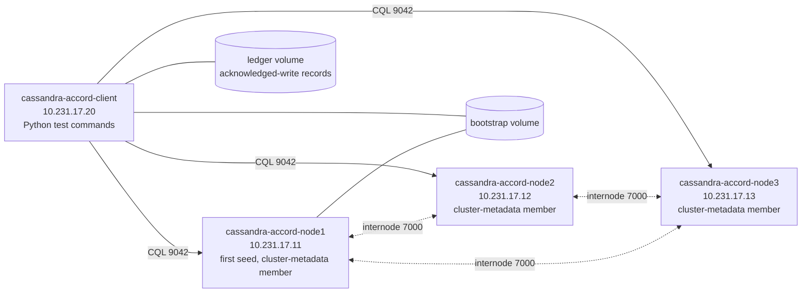

# boost: Apache Cassandra Accord · Apache Cassandra 6.0-alpha2 (with Accord)

**Status:** COMPLETE, with one early stop: a fix-verification run reported about an hour after its result deadline, so no further runs were launched after 05:25 UTC (a final round of hunts was skipped)
**Dates:** 2026-10-08 13:31 UTC → 2026-10-09 08:51 UTC · **Skill:** boost v0.7, variant baseline
**Budget used:** 16 runs (1 setup, 4 iteration, 7 hunt, 4 fix-verify) · run-hours 41.6 / 60 (the user raised the ceiling from 40 to 60 during the run) · elapsed 19 h 20 min
**User decisions during the run:** long test runs (hunts) used Antithesis's faster performance tier (`antithesis.performance_tier=turbo`); run-hour ceiling raised from 40 to 60.

## 1. Takeaway

Antithesis found three new bugs in the newest Cassandra release that ships Accord (6.0-alpha2, [`e874e3a9`](https://github.com/apache/cassandra/commit/e874e3a90b1942b945477e6d9ba03880b4f4a19d), Accord [`fff32de2`](https://github.com/apache/cassandra-accord/commit/fff32de2e915772fbc70d16b1c32346313877838)). Two of them break Accord's headline promise that transactions behave as if they ran one at a time, in real-time order (strict serializability). In V1, a transfer the client had been told was committed was overwritten (a lost update), and the bank's total stopped adding up. It first showed up 238.7 s into the simulation of the first 30-minute run, with only network faults, and it recurred in 12 of the 14 later runs, including runs with no node kills and a run with Cassandra's safe restart policy. In V2, a transaction read rows that had been committed long before as if they were absent. The third, V3, is a crash-recovery bug: if a node is killed while it is appending to the Accord journal, the journal can't be opened again and the node never restarts, under every restart policy Cassandra offers. All three survived an adversarial review that tried to blame the test harness. V3 is root-caused, and our patch let a node in the same state get through journal replay in a verification run. V1 and V2 are only partly root-caused, and our patches for them did not work. Most of the other alarms in the long runs were caused by a configuration choice we made (V4, explained in §8), and runs designed to separate the two cleared them: under the safe restart setting, the durability (G3), all-or-nothing (G2) and plain-CQL linearizability (G4) checks all passed over five hours with node kills. The known-bug check wasn't needed, because the same checks had already caught new bugs in the current release.

## 2. What we tested, and why it's recognizable

- **Apache Cassandra Accord:** Accord is the component that gives Apache Cassandra general multi-row, multi-table transactions (`BEGIN TRANSACTION … COMMIT TRANSACTION`) with strict serializability. It has no fixed leader: any node can coordinate a transaction, and if the coordinator dies, any other node can finish its work (recovery). It is developed as a library ([apache/cassandra-accord](https://github.com/apache/cassandra-accord)) and ships only inside Cassandra, pinned as the `modules/accord` git submodule ([system-brief.md](antithesis/scratchbook/system-brief.md)).
- **Under test:** Apache Cassandra @ `cassandra-6.0-alpha2` ([`e874e3a9`](https://github.com/apache/cassandra/commit/e874e3a90b1942b945477e6d9ba03880b4f4a19d)) with its Accord submodule at [`fff32de2`](https://github.com/apache/cassandra-accord/commit/fff32de2e915772fbc70d16b1c32346313877838). We chose it because it is the customer's own open-source software and builds from source ([sut-choice.md](antithesis/scratchbook/sut-choice.md)).
- **Why Accord engineers will recognize it:** Accord has no release tags of its own; users only get it inside Cassandra. 6.0-alpha2 is the newest Cassandra release that ships Accord. Its submodule commit `fff32de2` was at the tip of cassandra-accord history at the time and contains every Accord fix up to CASSANDRA-21440. A 3-node Cassandra 6.0-alpha2 cluster therefore runs the exact Accord code that the cassandra-accord committers ship (coordination, recovery, journal, per-key dependency tracking, durability scheduling), inside the integration they maintain.

## 3. Guarantees

Results on current come from all 16 runs: 4 iteration runs of 30 min, and 7 hunts of 300–360 min. Five hunts used the default test configuration. Two used configuration variants that differ only in how a killed node restarts and how often data is forced to disk (§4, §8). The pre-fix version was never run (§5).

| ID | Guarantee | Source | Current (6.0-alpha2) | Pre-fix (`c9ffe116`) |
|---|---|---|---|---|
| G1 | Multi-partition, multi-table transactions behave as if run one at a time in real-time order (strict serializability) | [transactions.adoc](https://github.com/apache/cassandra/blob/trunk/doc/modules/cassandra/pages/developing/cql/transactions.adoc) | ❌ violated: V1 and V2 (§6), in nearly every run, with or without node kills, and under the safe restart policy | not run (control moot) |
| G2 | All writes of one transaction become visible together or not at all (atomic commitment) | [transactions.adoc](https://github.com/apache/cassandra/blob/trunk/doc/modules/cassandra/pages/developing/cql/transactions.adoc) | ✅ passed under the safe restart policy ([0458bd36…][r-0458]: all five G2 checks passed). Failures appeared in two forms only. Without restarts, they belong to the V1/V2 family, most clearly the V2 shape, where a committed row reads as absent while the rest of its group holds the token ([1d499fea…][r-1d49] and [2accaa07…][r-2acc], no kills; [126cbacd…][r-126c] and [c16f5775…][r-c16f], in histories without restarts). The rest came after restarts under our unsafe restart setting (V4, §8). No mix of two different tokens in one group, which would be a partial write, was ever seen | not run (control moot) |
| G3 | A transaction acknowledged to the client survives a crash and restart of a minority of replicas (durability) | [transactions.adoc](https://github.com/apache/cassandra/blob/trunk/doc/modules/cassandra/pages/developing/cql/transactions.adoc) | ✅ passed under the safe restart policy, with node kills, over 5 h ([0458bd36…][r-0458]: 146, 632 and 1014 passing checks on the three G3 properties), and in every run without node kills. It failed only in runs that used our unsafe restart setting (harness-caused, V4, §8) | not run (control moot) |
| G4 | On a `transactional_mode='full'` table, ordinary single-statement CQL reads and writes are linearizable | [transactions.adoc](https://github.com/apache/cassandra/blob/trunk/doc/modules/cassandra/pages/developing/cql/transactions.adoc), [onboarding-to-accord.adoc](https://github.com/apache/cassandra/blob/cassandra-6.0-alpha2/doc/modules/cassandra/pages/managing/operating/onboarding-to-accord.adoc) | ✅ passed in 11 of the 14 runs that carried the G4 test, including the safe-restart hunt. It failed only in [42229a5d…][r-4222], [c16f5775…][r-c16f] and [72728337…][r-7272], all with node kills and our unsafe restart setting (V4, §8) | not run (control moot) |
| G5 | Once failures stop, a transaction succeeds again within 120 s (availability after recovery; the window is our inference, the docs give none) | [CEP-15](https://cwiki.apache.org/confluence/display/CASSANDRA/CEP-15%3A+General+Purpose+Transactions) | ❌ violated: V3 (§6), a node killed during a journal append never restarts. Passed in every run without node kills. Other G5 failures are unconfirmed leads (§6), because the 120 s window is shorter than Cassandra's own 900 s startup catch-up bound | not run (control moot) |

Full text and per-guarantee check design: [guarantees.md](antithesis/scratchbook/guarantees.md), [property-catalog.md](antithesis/scratchbook/property-catalog.md).

## 4. Environment

*Four containers on one bridge network with fixed addresses. Solid arrows: client requests over Cassandra's query protocol (CQL), spread over all three nodes. Dotted arrows: node-to-node traffic (Accord protocol messages, cluster-metadata log, gossip). Cylinders: shared volumes. `ledger` holds the client's record of acknowledged writes, so it survives client restarts. `bootstrap` lets node1's setup helper tell the client that the cluster-metadata service has 3 members. Every key is stored on all three nodes (replication factor 3), so any two nodes form a majority (quorum). Source: [deployment-topology.md](antithesis/scratchbook/deployment-topology.md), [docker-compose.yaml](antithesis/config/docker-compose.yaml).*

- **Software under test (current):**
  - **Apache Cassandra** cassandra-6.0-alpha2: [`e874e3a9`](https://github.com/apache/cassandra/commit/e874e3a90b1942b945477e6d9ba03880b4f4a19d) ([apache/cassandra](https://github.com/apache/cassandra)).
  - **Accord** (Cassandra's `modules/accord` submodule at that commit): [`fff32de2`](https://github.com/apache/cassandra-accord/commit/fff32de2e915772fbc70d16b1c32346313877838) ([apache/cassandra-accord](https://github.com/apache/cassandra-accord)), built as part of the Cassandra build.
  - Built from source with [antithesis/Dockerfile](antithesis/Dockerfile). Antithesis's Java coverage instrumentation covered the Cassandra and Accord jars: 163,547 code locations ([runs/setup-1.md](antithesis/scratchbook/runs/setup-1.md)). Full build provenance for every build, including the pre-fix, patched and configuration-variant ones, is in §11.
- **Faults:** Antithesis deliberately disrupted the system during the test (fault injection):
  - every run: network partitions, slowdowns and clogs between all containers;
  - full-fault runs: also node pauses, CPU throttling, node kills (SIGKILL) and graceful stops with restart, and clock jumps.

  Which runs used which set is in §8 and the runs table in §11.
- **Workload** (the test code, in Python with `cassandra-driver` 3.30.1 and the Antithesis Python SDK 0.4.0):
  - G1: a 12-account bank over two tables. Transfers are `BEGIN TRANSACTION` with reads, an `IF balance >= amount` condition and two updates. Read-only audits over all 12 accounts check the total and that per-account transfer counters never go backwards.
  - G2: each write puts one unique token into 2–4 rows across two tables, and readers check that all rows of a group hold the same token or none does.
  - G3: uniquely identified writes, recorded in a ledger on a shared volume and read back later, during and after faults.
  - G4: single-writer version counters written and read with plain CQL (no `BEGIN TRANSACTION`) on `transactional_mode='full'` tables.
  - G5: after faults stop, a probe retries transactions through each node for 120 s.
- **Tuning** (source [tuning.md](antithesis/scratchbook/tuning.md), applied in [cassandra-overrides.yaml](antithesis/sut/cassandra-overrides.yaml)). Every build uses these values, except the two configuration variants, which change only the rows marked † ([durable.sed](antithesis/sut/variants/durable.sed), [rebootstrap.sed](antithesis/sut/variants/rebootstrap.sed)):

| Setting | Test value | Production default | Why |
|---|---|---|---|
| `accord.shard_durability_cycle` | 20s | 5m | Per-shard durability rounds advance garbage-collection bounds many times per run (the project's own tests use 20s) |
| `accord.global_durability_cycle` | 20s | 5m | Cluster-wide durability, which gates erasing old transaction records |
| `accord.shard_durability_target_splits` | 4 | 8 | Durability rounds finish quickly on a small dataset (project test value) |
| `accord.retry_syncpoint` / `retry_durability` | `1s*attempts` | `10s*attempt <= 600s` | Retries happen on the timescale of the faults (project test value) |
| `accord.expire_syncpoint` | `1s*attempts<=300s` | `60s*attempts<=300s` | Stuck synchronization points expire on the fault timescale |
| `accord.recover_txn` | `1s*attempts <= 10s` | `5s*attempts <= 60s` | Recovery of stalled transactions starts sooner, including recovery racing a live coordinator |
| `accord.command_store_shard_count` / `queue_shard_count` | 2 / 2 | number of cores | Fewer internal shards, so more transactions contend on each (project test value) |
| `accord.journal.segment_size` | 1 MiB | 32 MiB | Journal segments roll over and get compacted often |
| `accord.journal.compaction_period` | 10000ms | 60000ms | Journal compaction, including removal of erased records, every few seconds |
| `accord.journal.flush_mode` / `commitlog_sync` † | PERIODIC / periodic (unchanged); `BATCH` / `batch` in the `cfg-durable` variant | same | Kept at production defaults so durability behaviour matches what users run. The `cfg-durable` variant forces every write to disk, to test whether data lost after kills was simply not yet synced |
| `memtable_heap_space` | 16MiB | ¼ heap | Frequent flushes to disk, so reads merge in-memory and on-disk data |
| `commitlog_segment_size` | 5MiB | 32MiB | Commit log segments roll over and recycle |
| `num_tokens` | 1 | 16 | Simple ring, as in the project's own Accord tests |
| `write_request_timeout` / `read_request_timeout` / `native_transport_timeout` | 10s / 10s / 30s | 2s in code (10s in the shipped yaml) / 5s / 12s | Transaction deadlines the project's tests also raise |
| `MAX_HEAP_SIZE` | 1536M | ½ RAM, capped | Bounded memory, so Accord's cache evicts and reloads from the journal |
| `accord.journal.stop_marker_failure_policy` † | `ALLOW_UNSAFE_STARTUP`; `REBOOTSTRAP` in the `cfg-rebootstrap` variant | `EXIT` | With the default, a node that was killed without a clean stop refuses to start again, so every node kill would be a permanent node loss. We chose `ALLOW_UNSAFE_STARTUP` at setup because `REBOOTSTRAP` hadn't started after 12+ min locally ([local-rebootstrap-stuck.txt](antithesis/scratchbook/logs/local-rebootstrap-stuck.txt)). Cassandra documents this setting as "VERY UNSAFE", and it turned out to cause false alarms of lost and stale data (V4, §8) |

- **Other configuration choices to disclose:**
  - Fixed container addresses (10.231.17.11–13 and .20). Without them, Antithesis restarts a killed container under a new address, and the cluster-metadata service, which keys members by address, wedged (§8).
  - On restart, a node lists all three nodes as seeds ([entrypoint.sh](antithesis/sut/entrypoint.sh)). On first boot node1 is the only seed, which keeps the node1 → node2 → node3 join order.
  - Cassandra logging at INFO instead of the stock DEBUG ([logback.xml](antithesis/sut/logback.xml)), to stay within Antithesis's output-volume limit.
  - The cluster-metadata service is reconfigured to 3 members during setup (`nodetool cms reconfigure 3`, [helper-cms-bootstrap.sh](antithesis/sut/helper-cms-bootstrap.sh)), so losing one node doesn't freeze schema and topology changes.
  - Hunts and the V3 fix-verification run used Antithesis's faster performance tier (`antithesis.performance_tier=turbo`), at the user's request.

### 4a. Test commands

The workload has 15 test commands in `antithesis/test/v1/accord/`: 9 drivers that Antithesis runs at random times while it injects faults (`parallel_driver_*`), 4 checkers that run after the drivers and faults have stopped (`eventually_*`), and 2 anytime checkers that run during faults (`anytime_*`). The `helper_*` files (`helper_accord.py`, `helper_durable.py`, `helper_fm.py`) are shared code, not commands. In all, the commands hold 66 assertions, 30 of them checks that must hold every time (`Always`-family assertions); the rest show that interesting situations were reached (`Sometimes`/`Reachable`) ([assertion-map.json](antithesis/scratchbook/assertion-map.json)).

**G1: transactions behave as if run one at a time, in real-time order**
- `parallel_driver_bank_transfers.py`: runs 8–80 transfers between the 12 bank accounts, mixed with read-only audits. Statements are prepared, and each runs exactly once (`FallthroughRetryPolicy`), so every outcome is either acknowledged or unknown. Every audit checks that the total is 12,000, no balance is negative, and the sum of transfer counters is even. Any read that starts after an acknowledged transfer must see that transfer's counter (real-time order). Unknown outcomes never raise these floors.
- `parallel_driver_bank_autoretry.py`: the same transfers sent the way a typical application would: unprepared CQL, the driver's default retry policy (which may retry silently), and up to 3 application resubmits after an unknown outcome. A transfer applied twice is still a whole transfer that conserves money, so the same audit checks stay sound. Every V1 failure in the first run came through this command's audits.
- `parallel_driver_rt_marker.py`: works on a private pair of accounts that no other client touches. Transfer *i* stamps marker *i* on both rows, guarded by an `IF` so a late older transfer can't overwrite a newer one. After each transfer, a new read-only transaction, usually through a different coordinator, must see both markers at or above every acknowledged marker, and a consistent balance.
- `anytime_bank_audit.py`: 3–20 back-to-back audits during faults, with or without the driver's retry policy. Each must be a consistent snapshot, and no account's counter may go backwards between consecutive audits.
- `eventually_bank_audit.py`: after faults stop, retries until up to two audits complete, then applies the same snapshot checks. Whether the cluster recovers in time is judged by G5, not here.

**G2: a transaction's writes become visible together or not at all**
- `parallel_driver_pair_writes.py`: writes one fresh token into every row of a group of 2–4 rows across two tables, using unconditional transactions, conditional compare-and-set transactions, or logged batches. Single attempts and auto-retry are both used. An ambiguous write may show up in all rows or in none, never in only some. Conditional writes and read-backs check that all rows agree.
- `parallel_driver_pair_reads.py`: concurrent readers that read a whole group in one transaction and check that every row holds the same token, or none has one yet.
- `eventually_pair_check.py`: after faults stop, reads every transactional and logged-batch group and checks the same all-or-none rule. Groups that can't be read within the time budget are skipped.

**G3: acknowledged writes survive crashes**
- `parallel_driver_durable_writes.py`: inserts uniquely identified rows into 1–3 partitions using transactions, conditional transactions or plain inserts, and records each attempt, acknowledgement or unknown outcome in a ledger on the shared volume.
- `parallel_driver_durable_readback.py`: writes in its own key range, then reads each acknowledged write back with a new statement, preferably through a different coordinator. A read that can't complete in its budget counts as unknown, not as loss.
- `anytime_durable_sample.py`: during faults, samples up to 100 acknowledged writes from the ledgers and checks that they are present with their values. The ledger line is read before the row, so the read always starts after the acknowledgement.
- `eventually_durable_check.py`: after faults stop, reads every acknowledged write in every ledger, retrying each read for up to 120 s. Rows from ambiguous writes may be present or absent.

**G4: plain CQL on full-mode tables is linearizable**
- `parallel_driver_fm_register.py`: owns 1–2 private keys and writes strictly increasing versions with plain `UPDATE`/`INSERT`, sometimes conditional. After each write it reads back with a plain `SELECT`, usually through another coordinator and at varying consistency levels. A read must return the latest acknowledged version or a newer one, and never a version that was never written. The client sends no timestamps of its own, so Accord picks all write timestamps.
- `parallel_driver_fm_readers.py`: reads keys that other writers have published with their acknowledged version, through varying coordinators. A read must return at least the published version, and one reader's reads of a key must never go backwards.

**G5: the cluster recovers after faults stop**
- `eventually_recovery_probe.py`: after faults stop, tries for 120 s to run a small read-write transaction through each of the three nodes as coordinator, plus a plain write and read. Any error or timeout counts as "not yet". A node that is still down at the end counts as a failure.

Outside the test commands: the client container runs [client_setup.py](antithesis/test/setup/client_setup.py). It waits until all three nodes see each other and node1's helper has reconfigured the cluster-metadata service to 3 members. It then creates the keyspace (replication factor 3) and tables `WITH transactional_mode='full'`, checks that a transaction succeeds through every node, and seeds the 12 accounts in one conditional transaction. Then it signals Antithesis that setup is done (`setup_complete`). The Cassandra build adds one `Reachable` marker at "Startup complete" ([0002-bootstrap-reachable-assertion.patch](antithesis/patches/common/0002-bootstrap-reachable-assertion.patch)). Antithesis's own default checks, such as "no unexpected container exits", also run; that is how V3 was detected. No long-running background checker is used.

## 5. Positive control: CASSANDRA-21440, "Expunged records may be resurrected"

- **Kind:** a real historical bug that shipped in 6.0-alpha1, not an injected mutation.
- **Bug:** [CASSANDRA-21440](https://issues.apache.org/jira/browse/CASSANDRA-21440). A replica could load a transaction whose records had been garbage-collected from the Accord journal as "never seen" instead of "erased", which the JIRA says "can lead to linearizability violations". Violates G1, as written in §3. To trigger it, garbage-collection bounds must advance and the journal must be purged, and then a late message, a recovery or a restart must reload that transaction. That needs network delay or partitions, or node pause or kill with restart, over a long run ([positive-control.md](antithesis/scratchbook/positive-control.md)).
- **Versions:** pre-fix Cassandra [`c9ffe116`](https://github.com/apache/cassandra/commit/c9ffe116457384200851939e3687f81c00015e02) (Accord [`0a10cd05`](https://github.com/apache/cassandra-accord/commit/0a10cd056794c05588114f45ce86d49d6d6538db)), the direct parent of the fix commit [`3d40c882`](https://github.com/apache/cassandra/commit/3d40c8825c8b06bcbd8378d698f6d2f3bf5dc25e) (Accord [`66cab49f`](https://github.com/apache/cassandra-accord/commit/66cab49f1c9af471795339a5fdf9522e6e73b691)).
- **Reproduced in Antithesis:** NO, because it was never run. The check was moot: its purpose is to show that the harness can catch a real bug, and new bugs on the current release (V1 first, then V2 and V3) had already passed the adversarial review. The pre-fix image `cassandra-accord-cassandra:c9ffe116` was built ([build-prefix.txt](antithesis/scratchbook/logs/build-prefix.txt), compose override [compose.prefix.override.yaml](antithesis/config/compose.prefix.override.yaml)), but no pre-fix run was launched. There is no time to first failure.
- **Same property on current:** failed (→ §6, V1 and V2).

## 6. Violations on the current version

Three violations stand after adversarial review. All were found on current [`e874e3a9`](https://github.com/apache/cassandra/commit/e874e3a90b1942b945477e6d9ba03880b4f4a19d).

### V1: an acknowledged transfer is overwritten; the bank total stops adding up (G1)
- **What broke:** under network faults alone, read-only audits saw totals of 11,992, 11,938 and 12,144 instead of 12,000, and odd transfer-counter sums, which no set of whole transfers can produce. A credit that had been acknowledged to the client was missing from a later transaction (a stale read) and showed up afterwards. The bad state was stored: different client processes read it through different coordinators. Single-attempt audits from separate commands also failed, so the client's retry behaviour is ruled out.
- **Impact for Accord users:** money is created or destroyed in exactly the multi-partition-transfer use case the docs advertise. An acknowledged commit can be partially undone by a concurrent transaction (a lost update). No error is raised.
- **Where found:** run [e4947374…][r-e494], first failure at vtime 238.69 ([failing log][log-v1]; moment input_hash=3115707109627864019 vtime=238.69260995578952; local log `antithesis/scratchbook/logs/iter1-3115707109627864019.log`). It was spotted while that run was still in progress.
- **How often:** the "bank total" check failed in 13 of the 15 runs that carried the bank test (12 of the 14 runs after the first). It failed 11 times in [83ddaf62…][r-83dd], 3 in [d59511b5…][r-d595] ([failing log][log-d595], moment input_hash=5035409406774088400 vtime=210.57465141965076), and 85–1,747 times in each of the 2–6 h runs. It failed in both hunts without node kills: 1,747 times in [1d499fea…][r-1d49] ([failing log][log-h4v1], moment input_hash=195445977575606314 vtime=215.9975963695906) and 1,447 times in [2accaa07…][r-2acc] ([failing log][log-h7v1], moment input_hash=6379511779244952771 vtime=144.9963628835976). It also failed 95 times in the safe-restart hunt [0458bd36…][r-0458] ([failing log][log-h6v1], moment input_hash=2907450730606066383 vtime=295.3396839166526). It was absent only in [126cbacd…][r-126c] (0 of 403 audits) and in the V1-patched run [0b77f2b9…][r-0b77] (0 of 682).
- **Adversarial verdict:** stands ([rca/V1-adversarial.md](antithesis/scratchbook/rca/V1-adversarial.md)). No node restarts or harness actions took place in the first failing history. Client timestamps are discarded by Accord. The tuned values change timing only. The checker holds for transfers applied any number of times. The later no-kill and safe-restart hunts rule out our restart setting as a cause.

### V2: committed rows are read as absent (G1)
- **What broke:** read transactions returned "no row" for accounts that were seeded in one transaction before the test started and that earlier transactions had read normally. Nothing in the workload deletes rows or writes nulls. One audit lost 7 of 12 rows at once (`accounts:3` plus all six `accounts_b` rows). The same 7-key set went missing in two independent runs. In the G2 test the same shape appears as one row of a group read as absent while the group's other rows hold the token.
- **Impact for Accord users:** a transaction can decide based on data that seems not to exist. For example, an `IF row IS NULL` branch can fire for a row that is there, or a read can return partial results with no error.
- **Where found:** first failure overall in run [83ddaf62…][r-83dd] ([failing log][log-v2]; moment input_hash=-3359217870427620869 vtime=155.43633017409593; local log `antithesis/scratchbook/logs/iter2--3359217870427620869.log`). It was also seen in [e4947374…][r-e494] at vtime 276.46 and 285.33 (local logs `antithesis/scratchbook/logs/iter1-4829813570422657959.ndjson`, `antithesis/scratchbook/logs/iter1-m8841521013045425404.ndjson`). It was identified as separate from V1 in run [0b77f2b9…][r-0b77], on a build with the V1 patch, where V1's symptoms were gone and this one remained ([failing log][log-fv1]; moment input_hash=6718656826655334244 vtime=253.57249954389408; local log `antithesis/scratchbook/logs/fv1-6718656826655334244.log`).
- **How often:** "every seeded bank account is visible" failed in 9 runs, including both no-kill hunts (44 in [1d499fea…][r-1d49], 47 in [2accaa07…][r-2acc]) and the safe-restart hunt (5 in [0458bd36…][r-0458]). The G2 form appeared without node kills in [1d499fea…][r-1d49] (local logs `antithesis/scratchbook/logs/hunt4-4577676815520121205.log`, `antithesis/scratchbook/logs/hunt4-8156848711228608486.log`).
- **Adversarial verdict:** stands ([rca/V2-adversarial.md](antithesis/scratchbook/rca/V2-adversarial.md)). No restarts. It appears on unpatched builds in many runs. Every read is a point read by full primary key in one transaction, and the seed was visible to earlier audits.

### V3: a node killed while appending to the Accord journal can never restart (G5)
- **What broke:** Antithesis killed node2 (SIGKILL) at vtime 217.58. On restart, Cassandra replayed its commit log fine, then failed to open the Accord journal with `JournalReadError … Crc$InvalidCrc: Read 0` and exited with code 3. Every later restart failed the same way, so node2 was gone for good. The journal file held an entry whose space had been reserved but whose contents and checksum had never been written, because the kill landed between the two steps. That is an ordinary state after a process kill.
- **Impact for Accord users:** a routine process crash (OOM kill, `kill -9`, container eviction) at the wrong instant makes a node unrecoverable without deleting journal files by hand, which loses the Accord state the journal exists to protect. Restarting with `REBOOTSTRAP`, Cassandra's documented recovery after an unclean stop, opens the journal first and fails the same way. The only escape is an undocumented setting, `crc_failure_on_rebuild_policy`, which defaults to `FAIL`. With one node permanently gone, any further fault leaves the cluster without a majority.
- **Where found:** run [c16f5775…][r-c16f] (360 min, full faults), Antithesis's default "container exit code 3" check, 45 failing examples that all trace back to this one event ([failing log][log-v3]; moment input_hash=-8545236388639200513 vtime=224.7137772119604; local log `antithesis/scratchbook/logs/hunt3--8545236388639200513.log`; the journal error itself is at vtime 224.19). The same `Read 0` failure appeared on node3 in [42229a5d…][r-4222] (vtime 153.51, 37 exit-3 examples) and in [a0534fbf…][r-a053] (vtime 156.66), so it happened in all three default-configuration hunts with node kills ([rca/V3.md](antithesis/scratchbook/rca/V3.md) §2).
- **Adversarial verdict:** stands, as "after a process kill during a journal append, the Accord journal cannot be opened under any stop-marker policy, including REBOOTSTRAP, with the default `crc_failure_on_rebuild_policy`" ([rca/V3-adversarial.md](antithesis/scratchbook/rca/V3-adversarial.md)). Our unsafe restart setting is not on the causal path; it only lets startup reach the journal open, as `REBOOTSTRAP` would. The review rejected a second part of the claim, that the whole cluster stayed unavailable for more than 120 s, as harness-caused: in that history all three nodes had been killed within 17.5 s, which goes beyond the minority-failure promise.

### Unconfirmed: leads and possible harness involvement
These failures are real observations but were not confirmed as bugs. Each has a specific doubt.
- **L1: a node's startup catch-up didn't finish after a clean restart.** In [a0534fbf…][r-a053], node1 was stopped gracefully (clean shutdown, safe replay markers written, no unsafe-startup warning). On restart, its Accord startup catch-up (bringing local state up to date with a quorum) finished for every table except the two bank tables, and it never opened CQL within the 120 s window. The other nodes answered at once ([failing log][log-l1]; moment input_hash=-7253961278733688370 vtime=267.81252991384827; local log `antithesis/scratchbook/logs/hunt2--7253961278733688370.log`; [runs/hunt-2.md](antithesis/scratchbook/runs/hunt-2.md)). Doubt: Cassandra's own catch-up deadline (`catchup_on_start_fail_latency`) is 900 s, and hunt-1 shows nodes reaching it ([runs/hunt-1.md](antithesis/scratchbook/runs/hunt-1.md)), so our 120 s window is stricter than the system's own bound.
- **L3: with `REBOOTSTRAP`, the cluster often can't serve transactions within 120 s after faults stop.** In the safe-restart hunt [0458bd36…][r-0458], "a transaction succeeded within 120 s" failed 24 times and "every node coordinated a transaction" 126 times ([failing log][log-l3]; moment input_hash=2779034862861778143 vtime=335.8714905695524; no local log downloaded). Locally, a rebootstrapping node was still not up after more than 12 minutes ([local-rebootstrap-stuck.txt](antithesis/scratchbook/logs/local-rebootstrap-stuck.txt)). Same doubt about the window as L1.
- **L4: Cassandra core, outside Accord: a node killed during compaction failed to start with "inconsistent disk state".** In the V3 fix-verification run [72728337…][r-7272], node2 was killed at vtime 595.96. On restart it died with `Failed to list directory files in …/system_schema/column_masks-…, inconsistent disk state for transaction [pa_txn_compaction_….log]` from the SSTable transaction log ([failing log][log-l4]; moment input_hash=-4857019936188895155 vtime=603.2130521018989; local log `antithesis/scratchbook/logs/fv3-exit3--4857019936188895155.log`). Not reviewed for harness involvement.
- **Side lead: two nodes restarting together block each other's topology fetch for about 2 minutes** (hunt-3, vtime ~239–353; [rca/V3-adversarial.md](antithesis/scratchbook/rca/V3-adversarial.md) part b). Worth testing with all three nodes healthy.
- **Restarted coordinator under a changed address:** in [0e194950…][r-0e19] (V1-patched build, full faults), one audit failed the total and even-counter checks right after its coordinator had restarted under a new IP address and logged "Could not catchup with peers; continuing to startup" (moment input_hash=1866202673575119510 vtime≈200.68; local log `antithesis/scratchbook/logs/fv2-1866202673575119510.log`; logs-explorer link in [false-positives.md](antithesis/scratchbook/false-positives.md)). The address change was a harness problem that was later removed, and V1 itself recurred in later runs with fixed addresses, so this case is most likely V1.

### Other observations (not counted as violations)
- **Secondary crash in the read-failure path:** a NullPointerException in `ExecuteTxn.onDone` → `TxnAdapter.persist` when a read-only transaction fails. Because of it, a read timeout reaches the client as a server error. Upstream already fixed it on trunk, as a side change in [CASSANDRA-21662](https://issues.apache.org/jira/browse/CASSANDRA-21662) ([rca/V1.md](antithesis/scratchbook/rca/V1.md) §5).
- **Internal consistency check failures on the doubly patched build:** in [ccc9549e…][r-ccc9] (V1 + V2 patches), nodes 1 and 2 printed stack traces from an Accord internal check (`Invariants.require`, "… not waiting on store …") in `ReadData.onOneSuccessInternal`, at vtime 334–339. The check is upstream code, not something our patch added. Not investigated ([rca/V2.md](antithesis/scratchbook/rca/V2.md)).
- **Uninvestigated default failures in hunt 1 and hunt 4:** a node2 exit with code 134 and a "java" default property in [42229a5d…][r-4222], and an Antithesis orchestrator exit in [1d499fea…][r-1d49] ([runs/hunt-1.md](antithesis/scratchbook/runs/hunt-1.md), [runs/hunt-4.md](antithesis/scratchbook/runs/hunt-4.md)).
- **Observed restriction:** Cassandra rejects a transaction that updates the same primary key and column names in two different tables ("Transaction contains multiple updates to the same key and fields"). The workload uses disjoint account ids across the two tables to stay clear of it ([helper_accord.py](antithesis/test/v1/accord/helper_accord.py)). This is a recorded behaviour, not a judgement on whether it's intended.

## 7. Root cause and fix

### V1: one transaction executed twice with different reads; the stale write set wins
- **Mechanism:** under message delay, a transfer whose client had already been told "committed" was executed a second time by another code path. That second execution read the accounts without a transfer that had committed just before, computed its writes from that stale snapshot, and stored them. The original writes were stored too, at a different timestamp, and each key ends up with whichever version has the higher timestamp. Accord fixes a transaction's write values when it executes, so two different value sets for one transaction can only come from two executions with different reads. In the code: Cassandra acknowledges the client before it sends `Apply`. A fast-path transaction sends no "stable" messages. Cassandra's default `MAY_BYPASS_SAFESTORE` lets `ReadData.applyFastRead` read, and `Apply.applyDirect` write, storage on the strength of a readiness flag captured when the transaction was first proposed (PreAccept). `applyDirect` writes before `Commands.apply` can detect a race with recovery, and recovery re-executes and stores its own writes. **Partial root cause:** the double execution is established from the data with high confidence. Why the second execution read without the earlier transfer is not established. The two ranked hypotheses are the safe-store bypass reading a stale snapshot, and recovery rebuilding dependencies without the earlier transfer ([rca/V1.md](antithesis/scratchbook/rca/V1.md) §3).
- **Evidence:** in one history, transfer T13 produced two write sets: 1157/2, from the read it returned to the client, and 1013/1, computed from the state before T144, which had already been acknowledged. Both became visible at different moments. In 5 of 5 failing histories, an Accord fast-path reconfiguration (a new epoch) and a timed-out, resubmitted transfer on the same hot account came before the first failure.
- **Our fix:** [`antithesis/fixes/V1.patch`](antithesis/fixes/V1.patch). It fixes the secondary NullPointerException, and it switches Cassandra's fast read and write execution default to Accord's own `MAY_BYPASS_COMMANDSFORKEY`. **Fix-verify: not verified.** The fix-verify build is current [`e874e3a9`](https://github.com/apache/cassandra/commit/e874e3a90b1942b945477e6d9ba03880b4f4a19d) + `patches/common` + V1.patch (`antithesis/patches/fixverify-V1/`, config `antithesis/config-fixverify-V1/`):
  - [0b77f2b9…][r-0b77] (network faults) had 0 of 682 audits fail, but [0e194950…][r-0e19] (full faults) had 1 suspect failure.
  - The build with both patches, [ccc9549e…][r-ccc9], had 38 of 730 audits fail the total check, starting at vtime 199.01 ([failing log][log-ccc9]; moment input_hash=-4914426880962309495 vtime=199.01325203687884; local log `antithesis/scratchbook/logs/fv2b--4914426880962309495.log`). The V2 patch never activated in that run, so it can't explain the failures.
  - The clean 0b77f2b9 run is best explained by chance: 30-minute network-only runs vary by about 10× even unpatched (11 and 96 failing audits).
- **Upstream comparison:** no matching report. Searches of Apache JIRA and the commit history found nothing matching the double-execution mechanism. The suspect defaults and code paths are unchanged on trunk (Cassandra trunk pinning Accord `56b7710a`). Only the secondary crash is fixed on trunk (CASSANDRA-21662). [CASSANDRA-21687](https://issues.apache.org/jira/browse/CASSANDRA-21687) touches nearby dependency bookkeeping, but we judged it not to be a fix. A draft upstream issue is in [rca/V1.md](antithesis/scratchbook/rca/V1.md) §5.
- **Caveat:** the blinding was procedural (the analysis was sealed with a hash before upstream was searched: `sha256:1c4cd312c07e9049`); the model may have seen this bug in training data.

### V2: rows held by the coordinator's other internal shards come back absent
- **Mechanism:** each node splits the keys it stores across several Accord internal shards (command stores), and a read asks each one for its share. In every failing read, only the first command store's rows reached the client. Rows owned by the node's other command stores were dropped without being reported as unavailable, so the coordinator treated them as absent instead of fetching them from another replica. **Partial root cause.** Established: the missing set is exactly "every command store except store 0", computed from Murmur3 tokens and the store-to-range assignments in the server's logs. The read is served from the coordinator's own replica. The fast-read bypass and Cassandra's result merging are ruled out. The exact faulty line is not established ([rca/V2.md](antithesis/scratchbook/rca/V2.md) §3).
- **Evidence:** 4 independent occurrences in 3 runs, with three different coordinators. The same 7 keys went missing in two runs, which the deterministic token-to-store split explains. No ERROR or internal-check line appeared near any failure. The two failures examined closely (in 0b77f2b9 and 83ddaf62) each came soon after a durability or journal-compaction round on the coordinator ([rca/V2-adversarial.md](antithesis/scratchbook/rca/V2-adversarial.md) §2). That timing is a lead, not a proven cause.
- **Our fix:** [`antithesis/fixes/V2.patch`](antithesis/fixes/V2.patch), a diagnostic with a fail-safe in `ReadData.java`. It logs and reports as unavailable any owned key that no local command store read. **Fix-verify: failed.** The build is current [`e874e3a9`](https://github.com/apache/cassandra/commit/e874e3a90b1942b945477e6d9ba03880b4f4a19d) + `patches/common` + V1.patch + V2.patch (`antithesis/patches/fixverify-V2/`, config `antithesis/config-fixverify-V2/`), run [ccc9549e…][r-ccc9]. The diagnostic never fired (0 matching events run-wide), yet committed rows were still read as absent 3 times. So the loss does not happen in the replica's `ReadData` reply. The next suspects are the coordinator's merge of replies, or a storage read that comes back empty.
- **Upstream comparison:** not known upstream. Probably still present on trunk: the code paths are unchanged, but since the faulty line isn't identified, this is a reading check only.
- **Caveat:** the blinding was procedural (analysis sealed with `sha256:e17249845e4080a7`); the model may have seen this bug in training data.

### V3: a half-written journal entry is treated as corruption, and startup fails permanently
- **Mechanism:** the Accord journal appends entries to a memory-mapped file in two steps. It first reserves space by writing the entry's length, then writes the body and, last, the checksums. A checksum of 0 is reserved to mean "never written". If the process is killed between the two steps, the file holds a slot with a valid length and a zero checksum. That entry was never flushed to disk and never acknowledged. On restart, the segment that was active at the kill has no metadata file, so the journal rebuilds it by scanning (`Metadata.rebuild`). The scan treats the whole file as if it had been flushed (`fsyncedLimit = Integer.MAX_VALUE`, Metadata.java:140), so it can't tell an unfinished tail from real corruption. With the default `crc_failure_on_rebuild_policy = FAIL`, it throws `JournalReadError` out of `AccordService.localStartup`. The metadata is never written, so every restart repeats the same scan and fails. **Root cause: established** with high confidence. Brute-forcing the logged checksum reproduces the exact on-disk header: a length marker pointing at offset 376460 followed by an all-zero key, and the stack trace matches the source line for line ([rca/V3.md](antithesis/scratchbook/rca/V3.md) §1, §3).
- **Evidence:** in [c16f5775…][r-c16f], 39 distinct moments between vtime 224.19 and 231.73 show the same error on the same file `log-1791488061546-1-1-1.data` with the same computed checksum. Every timeline that branches after the kill hits it, which fits a persistent on-disk state rather than a restart race. By contrast, the warning that marks a restart after a kill appears at more than 980 moments on all three nodes in the same run, and most of those restarts succeed, so the kill has to land inside the append window ([hunt3-events-journalreaderror.ndjson](antithesis/scratchbook/logs/hunt3-events-journalreaderror.ndjson)).
- **Our fix:** [`antithesis/fixes/V3.patch`](antithesis/fixes/V3.patch) (StaticSegment.java and Metadata.java, +49/−6). Only for a segment with no metadata file (one that was active at the crash), it treats the first entry with a valid length and a zero checksum as the end of the segment, and records that position. Closed segments, non-zero checksum mismatches and inconsistent lengths stay fatal as before. **Fix-verify: verified, with a caveat.** The build is current [`e874e3a9`](https://github.com/apache/cassandra/commit/e874e3a90b1942b945477e6d9ba03880b4f4a19d) + `patches/common` + V3.patch (`antithesis/patches/fixverify-V3/`, config `antithesis/config-fixverify-V3/`), run [72728337…][r-7272] (120 min, same faults as the run that found it):
  - The torn tail recurred: node2 was killed at vtime 386.46, and on restart the patch logged `Unfinished journal entry at offset 277678 … treating it as end of segment` at vtime 395.25, in four sibling timelines (moment input_hash=-4549965503131056392, WARN at vtime 395.2533; local log `antithesis/scratchbook/logs/fv3--4549965503131056392.log`; we have no exact failing-event moment for this line, so use the report link plus these values).
  - node2 then went through Accord journal replay without error. There were 0 journal-error exits in the run, against 45 in the unpatched run that found the bug.
  - Caveat: the timeline we downloaded ends at vtime 395.43, before Cassandra logs "Startup complete", so full startup was not observed on that branch. The run's one remaining exit 3 is the unrelated L4 compaction-log failure (§6).
- **Upstream comparison:** not known as a bug. The building blocks are known: [CASSANDRA-21355](https://issues.apache.org/jira/browse/CASSANDRA-21355) added an opt-in `IGNORE_CRC_ZERO_RECORDS` policy for exactly this zero-checksum case, but it applies to every rebuild, it isn't in `cassandra.yaml` or the docs, and the default stays `FAIL`. The affected journal files are byte-identical on trunk, so the bug is present on trunk (reading check). A draft upstream issue is in [rca/V3.md](antithesis/scratchbook/rca/V3.md) §5.
- **Caveat:** the blinding was procedural (analysis sealed with `sha256:6c301bc611abcf50`); the model may have seen this bug in training data. The patch was not compiled locally (no JDK); it compiled in the image build.

## 8. Method notes

- **Our own configuration choice caused the most instructive false alarm (V4).** Long runs with node kills reported lost acknowledged writes (G3), stale reads of single-writer registers (G4) and groups with missing rows (G2): in hunts [42229a5d…][r-4222], [a0534fbf…][r-a053], [c16f5775…][r-c16f] and [823089f6…][r-8230], and in [72728337…][r-7272]. Each one followed an unclean restart. At setup, we had set `accord.journal.stop_marker_failure_policy=ALLOW_UNSAFE_STARTUP`, a setting Cassandra documents as "VERY UNSAFE". Accord applies transaction writes to tables without the commit log (`TxnWrite.java:150`, `durableWrites=false`) and relies on journal replay to restore them after a crash. That replay can only be trusted after a clean stop, and this setting tells the node to trust it anyway. Two configuration-variant hunts, launched to separate the causes, cleared it:
  - [823089f6…][r-8230] (`cfg-durable`: commit log and journal forced to disk on every write, still the unsafe setting) still lost acknowledged writes ([failing log][log-v4]; moment input_hash=-14343964086619208 vtime=393.96688969805837; local log `antithesis/scratchbook/logs/hunt5--14343964086619208.log`). So the loss was not data that simply hadn't been synced yet.
  - [0458bd36…][r-0458] (`cfg-rebootstrap`: the documented safe restart policy, production sync settings) passed every G2, G3 and G4 check with node kills over 5 h, with heavy coverage: the three G3 checks passed 146, 632 and 1,014 times, and "rebootstrapping" was logged more than 500 times on all three nodes. G1 (V1, V2) still failed there.

  Verdict: harness-caused ([rca/V4-adversarial.md](antithesis/scratchbook/rca/V4-adversarial.md), [runs/hunt-5.md](antithesis/scratchbook/runs/hunt-5.md), [runs/hunt-6.md](antithesis/scratchbook/runs/hunt-6.md)). It was a judgement call at setup that `REBOOTSTRAP` was too slow to use. It cost false alarms across five runs and two separating hunts to clear them. The remaining doubt is that only one safe-restart run was made.
- **Other false positives and harness gaps caught before reporting** ([false-positives.md](antithesis/scratchbook/false-positives.md)):
  - *Container addresses change on restart.* Antithesis may give a restarted container a new IP address. With two of the three cluster-metadata members at stale addresses, the restarted nodes' address change could never commit, and the cluster stayed wedged past the 120 s recovery window. That looked like a G5 failure ([126cbacd…][r-126c]; [failing log][log-ipchurn], moment input_hash=-9161517995650739017 vtime=263.7104486739263; local log `antithesis/scratchbook/logs/iter3-m9161517995650739017.log`). Fixed with static addresses.
  - *Single seed.* A node restarting while node1 (the only seed) was down exited with code 3 ("The seed provider lists no seeds") and never came back ([failing log][log-exit3], moment input_hash=-3183840148574514038 vtime=142.36948019941337; local log `antithesis/scratchbook/logs/iter3-m3183840148574514038.log`). Fixed by listing all three nodes as seeds on restart.
  - *Unguarded client constructor.* `Cluster(...)` sat outside the connect retry loop, so commands crashed when no node name resolved. Fixed in `helper_accord.connect`.
  - *Output volume.* Stock DEBUG logging wrote 7.9 GB in 30 min. Fixed by switching to INFO.
  - *Must-hit markers for bad paths.* Two G3 markers for bad paths were set to "must be reached" and could never be reached. They were made optional.
  - *Whole-cluster outage in the V3 history* (V3 part b): all three nodes had been killed within 17.5 s, which goes beyond G5's minority-failure promise.
- **Runs to reach green:** 4 iteration runs. The harness was free of harness failures with network faults by [83ddaf62…][r-83dd] and with the full fault set by [d59511b5…][r-d595], after 2 rounds of harness fixes. "Green" here means that every remaining failure is V1 or V2.
- **Fault types used** (all runs used Antithesis's `boost_test` launcher):
  - Network only (partitions, slowdowns, clogs): setup [d86774c9…][r-d867], [e4947374…][r-e494], [83ddaf62…][r-83dd], [0b77f2b9…][r-0b77], [ccc9549e…][r-ccc9].
  - Full set (network plus node pause, CPU throttle, node kill or stop with restart on node1–3, and clock jumps): [126cbacd…][r-126c], [0e194950…][r-0e19], [d59511b5…][r-d595], hunts [42229a5d…][r-4222], [c16f5775…][r-c16f], [823089f6…][r-8230], [0458bd36…][r-0458], and [72728337…][r-7272].
  - Full set minus clock jumps: [a0534fbf…][r-a053].
  - Network, pause and throttle, no node kills: [1d499fea…][r-1d49] (no clock jumps) and [2accaa07…][r-2acc] (with clock jumps).
- **Fault types needed but unavailable:** none. Every fault type the positive control and the guarantees need is in the standard set.
- **Harness gaps:**
  - The Python SDK emits each assertion's details only once per process, so per-transfer read values and acknowledgement times were missing from the logs for some later failures. This limited the V1 analysis on the patched build and the V4 analysis.
  - No Accord TRACE logging was enabled, so the two executions of a V1 transaction can't be named from the logs.
  - Cross-timeline counts in the Logs Explorer weren't available to the analysis, which needs browser access. The analysis used `snouty runs events` and log downloads instead.
  - The G5 window (120 s) is shorter than Cassandra's own startup catch-up bound (900 s), which left the G5 failures in L1 and L3 unconfirmed.
- **Recurring warnings:**
  - Antithesis's "Customer output volume" check failed in the long hunts (e.g. 248 MB per core-hour in [c16f5775…][r-c16f], against 200 recommended). The cause is verbose JVM garbage-collection logging plus duplicate JSON and text Cassandra logs. Harness noise, not a Cassandra issue.
  - Unexpected container exits with code 3 recurred in hunts with node kills (37 in [42229a5d…][r-4222], 45 in [c16f5775…][r-c16f], 1 in [a0534fbf…][r-a053]). They were traced to V3, except the one in [72728337…][r-7272], which is L4.
- **Coverage markers:** in the 30-minute runs, three G4 coverage markers were never hit (a reader seeing a published register advance; a multi-key `IN` read completing; a declined conditional write being evaluated). All three were hit in the long hunts (e.g. 37, 53 and 39 times in [c16f5775…][r-c16f]).
- **Notable:**
  - V1 was first spotted from live event queries while its run was still in progress (vtime 238.69), about 15 min after launch.
  - Root-cause work used its full attempt budget for V1 and V2 and stopped at a partial root cause.
  - The V2 and V3 patches were checked with `git apply --check` but not compiled locally (no JDK on the machine). They compiled in the image build.
  - The fix-verification run for V3 had not reported 150 min after launch. Following the stop rule, no further runs were launched after 05:25 UTC, and a final round of hunts (more safe-restart runs among them) was skipped. That run, and hunts 5–7, reported later and are included here.

## Still running at the deadline

None. All 16 runs finished and are included in this summary.

## 9. Content hooks

- "In the first 30-minute run, with only network faults, Antithesis found an acknowledged Accord transfer being overwritten. The bank's 12,000 total became 11,992." (V1, [e4947374…][r-e494], vtime 238.69)
- "One `kill -9` at the wrong instant, and a Cassandra node can never start again, even with the documented recovery setting." (V3, [c16f5775…][r-c16f]). Diagram candidate: the two-step journal append (length first, checksum last), the kill landing between them, and the restart scan that treats the unfinished tail as corruption.
- "The same seven rows vanished in two independent runs, because Murmur3 tokens and the command-store split are deterministic." That is a strong diagram candidate: the 12 keys, their tokens and the command stores, with the missing ones highlighted ([rca/V2.md](antithesis/scratchbook/rca/V2.md) §3).
- Blog angle, "our own false alarm": a documented "VERY UNSAFE" restart setting, chosen at setup, produced lost-write alarms in five runs. Two separating runs, one forcing every write to disk and one using the safe restart policy, showed which failures were the system's and which were ours. Diagram: a 2×2 of (unsafe vs safe restart) × (kills vs no kills), with G1 failing in every cell and G3 failing only in the unsafe cell with kills.
- Blog angle: "the fix that looked like it worked". A clean 30-minute run on the V1 patch (0 of 682) was luck: a combined build failed 38 times. This makes the case for repeated, independent runs before declaring a fix verified.
- Diagram: V1's "one transaction, two write sets" timeline. T144 is acknowledged; T13 reads it and returns 1157/2 to the client; then an audit sees 1013/1, and later 1157/2 ([rca/V1.md](antithesis/scratchbook/rca/V1.md) §2).

## 10. Not reached / open questions

- A final round of hunts was skipped after the early stop (no launches after 05:25 UTC). More safe-restart (`REBOOTSTRAP`) runs were the obvious next step: the G2/G3/G4 passes under safe restart rest on one 300-minute run.
- Positive control not run. The pre-fix image is built, but its harness config directory was never rendered and no pre-fix run was launched.
- V1: which code path performs the second, stale execution (safe-store bypass vs recovery rebuilding dependencies) is unknown. The next step is Accord TRACE logging on `Recover`/`Apply`/`ReadData` for the hot keys.
- V2: where the rows are lost on the coordinator side (merging replies, the read tracker, or a storage read that comes back empty) is unknown. Whether durability or journal-compaction rounds trigger it is a lead, not established.
- V3: full node startup after the patch's truncation was not observed in a downloaded timeline (the branch ended during journal replay). The patch has no unit test yet (one is suggested in [rca/V3.md](antithesis/scratchbook/rca/V3.md) §4).
- L1 and L3: whether startup catch-up and rebootstrap converge within Cassandra's own 900 s bound. A G5 variant with that window would settle it.
- L4: the SSTable compaction-log startup failure after a kill has not been reviewed.
- Whether the shorter recovery delay we tuned (`recover_txn` 1 s instead of 5 s) changes how often V1 occurs. Not measured.
- The cluster-metadata service wedging when most members change address before the change commits. Not investigated beyond the harness fix.
- The `Invariants.require` "not waiting on store" stack traces on the V1+V2 build. Not investigated.

## 11. Artifacts

**Links carry access, so treat them as sensitive.** Every report link below embeds an access token (`?auth=…`), and anyone with the link can open the report. Logs-explorer ("failing log") links need a login to the Antithesis tenant. Don't paste either kind into customer-facing material without deciding that on purpose.

| What | Where |
|---|---|
| State / log | `antithesis/scratchbook/boost-state.json`, `antithesis/scratchbook/boost-log.md` |
| Research | `antithesis/scratchbook/inputs.md`, `system-brief.md`, `sut-choice.md`, `sut-analysis.md`, `deployment-topology.md`, `property-catalog.md`, `tuning.md` |
| Guarantees | `antithesis/scratchbook/guarantees.md` |
| Harness | `antithesis/Dockerfile`, `antithesis/sut/` (incl. `sut/variants/`), `antithesis/config/`, `antithesis/config-fixverify-V1/`, `antithesis/config-fixverify-V2/`, `antithesis/config-fixverify-V3/`, `antithesis/config-hunt-durable/`, `antithesis/config-hunt-rebootstrap/`, `antithesis/test/`, `antithesis/patches/` |
| Assertions | `antithesis/scratchbook/assertion-map.json` |
| Triage | `antithesis/scratchbook/runs/`, `antithesis/scratchbook/logs/props-*.json`, `antithesis/scratchbook/false-positives.md` |
| RCAs / fixes | `antithesis/scratchbook/rca/` (V1, V2, V3 analyses; V1–V4 adversarial reviews), `antithesis/fixes/` (V1, V2, V3 patches) |
| Positive control | `antithesis/scratchbook/positive-control.md`, `antithesis/config/compose.prefix.override.yaml` |

**Runs**

| Run | Purpose | Build | Faults | Duration | Outcome |
|---|---|---|---|---|---|
| [d86774c9…][r-d867] | setup smoke | current | network | 5 min | all 32 properties pass; instrumentation confirmed |
| [e4947374…][r-e494] | iteration 1 (G1 only) | current | network | 30 min | V1 found (live); V2 symptoms; output-volume harness gap |
| [83ddaf62…][r-83dd] | iteration 2 (G1–G5) | current | network | 30 min | G1 fails (V1, V2); G2–G5 pass |
| [0b77f2b9…][r-0b77] | fix-verify V1 #1 | current + V1.patch | network | 30 min | V1 checks pass (0/682); V2 isolated |
| [126cbacd…][r-126c] | iteration 3 | current | full | 30 min | 3 harness false positives; G2 failure (V2 shape) |
| [0e194950…][r-0e19] | fix-verify V1 #2 | current + V1.patch | full | 30 min | same harness false positives; 1 suspect G1 failure |
| [ccc9549e…][r-ccc9] | fix-verify V2 (+V1) | current + V1.patch + V2.patch | network | 30 min | G1 fails 38× (total) and 3× (missing row): both fixes fail |
| [d59511b5…][r-d595] | iteration 4 | current | full | 30 min | harness clean; only V1 (3) |
| [42229a5d…][r-4222] | hunt 1 | current | full, turbo | 300 min | V1, V2; V3 on node3; G2/G3/G4 failures harness-caused (V4); G5 lead (L1) |
| [a0534fbf…][r-a053] | hunt 2 | current | full minus clock jumps, turbo | 300 min | V1, V2; V3 on node3; G2/G3 harness-caused (V4); G5 after a clean restart (L1); G4 passes |
| [c16f5775…][r-c16f] | hunt 3 | current | full, turbo | 360 min | **V3 found** (node2 never restarts, 45×); V1, V2; G3/G4 harness-caused (V4) |
| [1d499fea…][r-1d49] | hunt 4 | current | network + pause + throttle, no kills, turbo | 300 min | V1 (1,747), V2 incl. G2 shape; G3, G4, G5 pass |
| [823089f6…][r-8230] | hunt 5 | `cfg-durable` (commit log and journal forced to disk on every write; unsafe restart) | full, turbo | 300 min | G3 still loses acknowledged writes → V4 harness-caused; V1; G5 every-node fails |
| [0458bd36…][r-0458] | hunt 6 | `cfg-rebootstrap` (safe restart policy) | full, turbo | 300 min | G2, G3, G4 pass with kills; V1, V2 persist; G5 fails (L3) |
| [2accaa07…][r-2acc] | hunt 7 | current | network + pause + throttle + clock jumps, no kills, turbo | 300 min | V1 (1,447), V2, G2 (26, V1/V2 family); G3, G4, G5 pass |
| [72728337…][r-7272] | fix-verify V3 | current + V3.patch | full, turbo | 120 min (reported about an hour after its result deadline) | V3 verified with caveat (0 journal exits vs 45); L4 found; V1, V4-type failures as in other kill runs |

Full run IDs: setup [d86774c9146cbd065a327fe82351ccd0-63-12][r-d867]; iterations [e4947374c51cfdaaffd0d6ff6ae5dc10-63-12][r-e494], [83ddaf621438954613d378b310199d39-63-12][r-83dd], [126cbacda11c1e49afda49c425a00f31-63-12][r-126c], [d59511b5246c23175adaf49eec9cfeae-63-12][r-d595]; hunts [42229a5d3c2580dbfcf6cf6dd13c5cc5-63-12][r-4222], [a0534fbf86e5081d495f8d15d9ccf329-63-12][r-a053], [c16f5775181c00d7a3ac9d8a7607de32-63-12][r-c16f], [1d499fea4f9ce6971e413c613736faf2-63-12][r-1d49], [823089f61fb59e015811e6e85ed39aa6-63-12][r-8230], [0458bd361e685fcd215c0f52bee40ab2-63-12][r-0458], [2accaa077ceeb8bdd68fb53122e70ba4-63-12][r-2acc]; fix-verify [0b77f2b9a794d868ae0d8e6cca24880e-63-12][r-0b77], [0e1949506e0ec5407eb17348c627c8a3-63-12][r-0e19], [ccc9549ea4ea7c01d4f19e8f3c4ba0d9-63-12][r-ccc9], [72728337f011528b627e81d1f2315090-63-12][r-7272].

### Build provenance

Every build that ran (or was prepared), what it's made of, and where it's defined. "Config" is the harness directory passed to `snouty launch`. Every build uses [antithesis/Dockerfile](antithesis/Dockerfile) and differs only in the build args `SUT_REF`, `PATCH_SET` and `CONFIG_VARIANT`.

| Build | Component | Repository | Version | Commit | Patches on top | Config | Runs |
|---|---|---|---|---|---|---|---|
| current | Apache Cassandra | [apache/cassandra](https://github.com/apache/cassandra) | cassandra-6.0-alpha2 | [`e874e3a9`](https://github.com/apache/cassandra/commit/e874e3a90b1942b945477e6d9ba03880b4f4a19d) | Antithesis Java SDK dependency + startup `Reachable` (`antithesis/patches/common/`) | `antithesis/config/` | setup, iterations 1–4, hunts 1–4 and 7 |
| current | Accord | [apache/cassandra-accord](https://github.com/apache/cassandra-accord) | submodule of the above | [`fff32de2`](https://github.com/apache/cassandra-accord/commit/fff32de2e915772fbc70d16b1c32346313877838) | none | (same image) | every current, variant and fix-verify build |
| cfg-durable | Cassandra + Accord | as current | current, config variant | base [`e874e3a9`](https://github.com/apache/cassandra/commit/e874e3a90b1942b945477e6d9ba03880b4f4a19d) | `patches/common`; `CONFIG_VARIANT=durable` applies `antithesis/sut/variants/durable.sed` (commit log `batch`, journal `BATCH`) | `antithesis/config-hunt-durable/` | [823089f6…][r-8230] |
| cfg-rebootstrap | Cassandra + Accord | as current | current, config variant | base [`e874e3a9`](https://github.com/apache/cassandra/commit/e874e3a90b1942b945477e6d9ba03880b4f4a19d) | `patches/common`; `CONFIG_VARIANT=rebootstrap` applies `antithesis/sut/variants/rebootstrap.sed` (stop-marker policy `REBOOTSTRAP`) | `antithesis/config-hunt-rebootstrap/` | [0458bd36…][r-0458] |
| pre-fix | Apache Cassandra | [apache/cassandra](https://github.com/apache/cassandra) | parent of fix [`3d40c882`](https://github.com/apache/cassandra/commit/3d40c8825c8b06bcbd8378d698f6d2f3bf5dc25e) | [`c9ffe116`](https://github.com/apache/cassandra/commit/c9ffe116457384200851939e3687f81c00015e02) | `antithesis/patches/common/` | `antithesis/config/compose.prefix.override.yaml` (a separate pre-fix config directory was never rendered) | built, never run: new bugs on current made the check moot |
| pre-fix | Accord | [apache/cassandra-accord](https://github.com/apache/cassandra-accord) | submodule of the above (fix is [`66cab49f`](https://github.com/apache/cassandra-accord/commit/66cab49f1c9af471795339a5fdf9522e6e73b691)) | [`0a10cd05`](https://github.com/apache/cassandra-accord/commit/0a10cd056794c05588114f45ce86d49d6d6538db) | none | (same image) | not run |
| fix-verify V1 | Cassandra + Accord | as current | current + V1 | base [`e874e3a9`](https://github.com/apache/cassandra/commit/e874e3a90b1942b945477e6d9ba03880b4f4a19d) | common + `zz-fix-V1.patch` (= `antithesis/fixes/V1.patch`), in `antithesis/patches/fixverify-V1/` | `antithesis/config-fixverify-V1/` | [0b77f2b9…][r-0b77], [0e194950…][r-0e19] |
| fix-verify V1+V2 | Cassandra + Accord | as current | current + V1 + V2 | base [`e874e3a9`](https://github.com/apache/cassandra/commit/e874e3a90b1942b945477e6d9ba03880b4f4a19d) | common + `zy-fix-V1.patch` (= V1.patch) + `zz-fix-V2.patch` (= `antithesis/fixes/V2.patch`), in `antithesis/patches/fixverify-V2/` | `antithesis/config-fixverify-V2/` | [ccc9549e…][r-ccc9] |
| fix-verify V3 | Cassandra + Accord | as current | current + V3 | base [`e874e3a9`](https://github.com/apache/cassandra/commit/e874e3a90b1942b945477e6d9ba03880b4f4a19d) | common + `zz-fix-V3.patch` (= `antithesis/fixes/V3.patch`), in `antithesis/patches/fixverify-V3/` | `antithesis/config-fixverify-V3/` | [72728337…][r-7272] |

Components used as released artifacts rather than built from source:
- **Build images:** `eclipse-temurin:11-jdk@sha256:8db2bcf62ae171d1247c331db0410d8bc6347e7493bdafe104bb9a33d59c1291` (toolchain, with Apache Ant 1.10.14) and `eclipse-temurin:11-jre@sha256:ad419849e59e2c7a325078dff5eb64db6f61c8872e316dfd501031ed72efc2dd` (runtime), from `antithesis/scratchbook/logs/build-sut-e874e3a9.txt`.
- **SUT images as built:** `cassandra-accord-cassandra:e874e3a9` (registry digest `sha256:6ab2501f53aaca0c84a6f459d214e8c115ed57cf233822b98d4e2a326c18e98d`); `…:e874e3a9-fix-V3` (local manifest list `sha256:82db04a387fde2b1ff1de709e026f1e0865a0fa60a0f8ffcf600d698d26c085e`, [build-fixverify-V3.txt](antithesis/scratchbook/logs/build-fixverify-V3.txt)); `…:e874e3a9-cfg-durable` (`sha256:cfaf5dcb641f118408243c371e47132d11bf77916a5cb9c298f0c688f0822512`, [build-hunt-durable.txt](antithesis/scratchbook/logs/build-hunt-durable.txt)); `…:e874e3a9-cfg-rebootstrap` (`sha256:fa648390e1165a86e4817088c94eaa2de62e793c3bbb0323a2a7811ee8566806`, [build-hunt-rebootstrap.txt](antithesis/scratchbook/logs/build-hunt-rebootstrap.txt)).
- **Test client image:** `cassandra-accord-workload:63f7cc96e480` (registry digest `sha256:e9a5611c014ac3857ced58750a3f6f41c78e9cd46a8b105e71a0ae2de051f69b`), used by iteration 4, all hunts and fix-verify V3; based on `python:3.11-slim-bookworm` (base digest not recorded), with `cassandra-driver==3.30.1` and `antithesis==0.4.0`. Earlier runs used earlier workload images: `3220b5f4f8ba` (setup), `4246884a53c3` (iteration 1), `772c2f7e081f` (iterations 2–3, fix-verify V1 #1–2), `ccc68eedd897` (fix-verify V2).
- **Coverage runtime / SDK:** Antithesis Java SDK `com.antithesis:sdk` and `com.antithesis:ffi` 1.7.0 from Maven Central (digest not recorded). Instrumentation was applied by Antithesis to the Cassandra and Accord jars exposed under `/opt/antithesis/catalog`.

[r-d867]: https://honey-whale.antithesis.com/report/FxcyD1gLlrispQT5Won2yben/WduHcL8un39ZDuEa2B0dIzOIZQA3zIJp0faSH0wUcv4.html?auth=v2.public.eyJzY29wZSI6eyJSZXBvcnRTY29wZVYxIjp7ImFzc2V0IjoiV2R1SGNMOHVuMzlaRHVFYTJCMGRJek9JWlFBM3pJSnAwZmFTSDB3VWN2NC5odG1sIiwicmVwb3J0X2lkIjoiRnhjeUQxZ0xscmlzcFFUNVdvbjJ5YmVuIn19LCJuYmYiOiIyMDI2LTEwLTA4VDE0OjEyOjI4LjIyODUxOTMyOFoifburKuVu8fyGYu_Eu7kdTcQMFw8aOCQaFPJaZsIS1qId4pMOHplD6jykkOnWUNLtFryNFhvq5zcPHSclF_TfRQA
[r-e494]: https://honey-whale.antithesis.com/report/xrIBSxLwAHWhRf49AROCTaMK/yWwNglWJp3ThXiESihRapRCIs7Pwz7ROGJpTVNx0uxU.html?auth=v2.public.eyJuYmYiOiIyMDI2LTEwLTA4VDE1OjA4OjE1LjkyNDI3NDUzOFoiLCJzY29wZSI6eyJSZXBvcnRTY29wZVYxIjp7ImFzc2V0IjoieVd3TmdsV0pwM1RoWGlFU2loUmFwUkNJczdQd3o3Uk9HSnBUVk54MHV4VS5odG1sIiwicmVwb3J0X2lkIjoieHJJQlN4THdBSFdoUmY0OUFST0NUYU1LIn19fVe7MBHDdXkUUFSrjqed0PclvzX2NZKVJ5I8PaDlT0I1lpSuezQCi6_TaC8jVV1BULZeH7_RwR2JEBhNfVArCw4
[r-83dd]: https://honey-whale.antithesis.com/report/2kEKMku2Ei7pS75t3iDKhVbx/j8fGuFgyCTLqn_ZYwhVR_WR9aLOJKc0MbEjI8xCgQpw.html?auth=v2.public.eyJuYmYiOiIyMDI2LTEwLTA4VDE2OjAyOjE1LjQzNjY0OTA1MVoiLCJzY29wZSI6eyJSZXBvcnRTY29wZVYxIjp7ImFzc2V0IjoiajhmR3VGZ3lDVExxbl9aWXdoVlJfV1I5YUxPSktjME1iRWpJOHhDZ1Fwdy5odG1sIiwicmVwb3J0X2lkIjoiMmtFS01rdTJFaTdwUzc1dDNpREtoVmJ4In19fUDXnp8uHRyAkW1TKXuyGEnf5ad6JXRwY8XbPjTPaWFDERrThAM_peYjzYhAFaUy6lhTRHwLZtnIwHTvA_ljagM
[r-0b77]: https://honey-whale.antithesis.com/report/IwjECCMMfn8ttNe3O2q6VpBk/y70rTIP4TaJV1syBnP0RWh6mhWeMzW2cVqkkqXDWRYA.html?auth=v2.public.eyJzY29wZSI6eyJSZXBvcnRTY29wZVYxIjp7ImFzc2V0IjoieTcwclRJUDRUYUpWMXN5Qm5QMFJXaDZtaFdlTXpXMmNWcWtrcVhEV1JZQS5odG1sIiwicmVwb3J0X2lkIjoiSXdqRUNDTU1mbjh0dE5lM08ycTZWcEJrIn19LCJuYmYiOiIyMDI2LTEwLTA4VDE2OjA0OjAwLjU0NTAzNzI4N1oifVgqM5p8JmpqTrJNfXkHe-u_7Wk_pfTWpvRceqnBiyttiopD_3bctLgkMbRlQc1q5E3EUWrASgjoGQxllwKrMwc
[r-126c]: https://honey-whale.antithesis.com/report/zmTGhQqT5crjapLTREVHyQo1/n3y3NkFh_T7O71fouh6SAB89DacwGkLqFUeQBBl_wCo.html?auth=v2.public.eyJuYmYiOiIyMDI2LTEwLTA4VDE2OjUzOjMzLjk3NTkyMjEyNFoiLCJzY29wZSI6eyJSZXBvcnRTY29wZVYxIjp7ImFzc2V0IjoibjN5M05rRmhfVDdPNzFmb3VoNlNBQjg5RGFjd0drTHFGVWVRQkJsX3dDby5odG1sIiwicmVwb3J0X2lkIjoiem1UR2hRcVQ1Y3JqYXBMVFJFVkh5UW8xIn19fZ9r5g_OdCrQRJ1zvWuRLOwh7d9AV5C31dgO2snRuRecDcJHw4OVlwbwiP-DOd020EI0bf0g6QnVoq97K4lZmAk
[r-0e19]: https://honey-whale.antithesis.com/report/1m1Ur9qEIU4qMIV6bVIJALEA/TZXCICByv8d1_9cYxLwOit-JGi3xkzPHbasNfHMMLcE.html?auth=v2.public.eyJuYmYiOiIyMDI2LTEwLTA4VDE2OjUzOjMzLjg0MzAwNTQ2MloiLCJzY29wZSI6eyJSZXBvcnRTY29wZVYxIjp7ImFzc2V0IjoiVFpYQ0lDQnl2OGQxXzljWXhMd09pdC1KR2kzeGt6UEhiYXNOZkhNTUxjRS5odG1sIiwicmVwb3J0X2lkIjoiMW0xVXI5cUVJVTRxTUlWNmJWSUpBTEVBIn19fYRMwrkd2H--hy32gsQF2UrB5cW93Y848VKOv1g5hnJSqlsgMIE2PmVkcLF8QqXEllbUn3BJk5KjacXN5k-TeQg
[r-ccc9]: https://honey-whale.antithesis.com/report/KfY7B2UuKvIX6-mUzOaSxMLD/ISGa8Ar3YHqzNOLEqCKFE9EbNKaW6MSN8s9nJeOA5_Y.html?auth=v2.public.eyJuYmYiOiIyMDI2LTEwLTA4VDE3OjQ4OjAwLjYyMDk3MDEwN1oiLCJzY29wZSI6eyJSZXBvcnRTY29wZVYxIjp7ImFzc2V0IjoiSVNHYThBcjNZSHF6Tk9MRXFDS0ZFOUViTkthVzZNU044czluSmVPQTVfWS5odG1sIiwicmVwb3J0X2lkIjoiS2ZZN0IyVXVLdklYNi1tVXpPYVN4TUxEIn19fYHSb1vJZI8JwTCuQ9ZVhszgoXnANQW1WQmRA6j643Q0TlgzZfuZSh7oot8SsxgMJ1F9JY2RuT2LiNcqCTdqMw8
[r-d595]: https://honey-whale.antithesis.com/report/UqrKVMj_GYKoSwH214E9k-55/-wUPEd0enCQ95AFtBqXT6Q2CBmFAh6STLDboBRJyD0U.html?auth=v2.public.eyJuYmYiOiIyMDI2LTEwLTA4VDE4OjE5OjUyLjU5MzI4MjYwOFoiLCJzY29wZSI6eyJSZXBvcnRTY29wZVYxIjp7ImFzc2V0IjoiLXdVUEVkMGVuQ1E5NUFGdEJxWFQ2UTJDQm1GQWg2U1RMRGJvQlJKeUQwVS5odG1sIiwicmVwb3J0X2lkIjoiVXFyS1ZNal9HWUtvU3dIMjE0RTlrLTU1In19fShbOf9MEd5TA5g4C_CJgAKHIxNI3_0DFXcSzkqE7e6XkpQ1F7W9CV6UtShB54WtAyUkqbpWWuMnPkhqSAV0vgY
[r-4222]: https://honey-whale.antithesis.com/report/NktZzXJr0UO579BjgdL5Mfs8/WahXSL5t4V92DlKQs1q_ypABQrL0eoB0t4m9lTR2aRQ.html?auth=v2.public.eyJuYmYiOiIyMDI2LTEwLTA5VDAwOjQ1OjUwLjE3MzY4NTQyNloiLCJzY29wZSI6eyJSZXBvcnRTY29wZVYxIjp7ImFzc2V0IjoiV2FoWFNMNXQ0VjkyRGxLUXMxcV95cEFCUXJMMGVvQjB0NG05bFRSMmFSUS5odG1sIiwicmVwb3J0X2lkIjoiTmt0WnpYSnIwVU81NzlCamdkTDVNZnM4In19fWrNFp5DNmFdjXAMDyLShAIiDFVbFBq3o-ivCj39i3X6r5xWrcK63PhPBBMfCW9XFdEfA-U-ykSWQds9ci3dMAE
[r-a053]: https://honey-whale.antithesis.com/report/Yrr8xPIhKvFwB5cxwbUjo71N/Tm3uCc675KWtl0XjMrwy-dUm6jzy_CBpF7n9t6Abiac.html?auth=v2.public.eyJzY29wZSI6eyJSZXBvcnRTY29wZVYxIjp7ImFzc2V0IjoiVG0zdUNjNjc1S1d0bDBYak1yd3ktZFVtNmp6eV9DQnBGN245dDZBYmlhYy5odG1sIiwicmVwb3J0X2lkIjoiWXJyOHhQSWhLdkZ3QjVjeHdiVWpvNzFOIn19LCJuYmYiOiIyMDI2LTEwLTA5VDAwOjUxOjEzLjYzNDE5NjA3NloifVZ8QpGpm__rQ6n-dlgWEtEZ7XGKnMDfCqEmwwxwDmgxYqPfOKeW-AW2lt_3S8p9YYsaHUvE6MqbNI69FpADSwI
[r-c16f]: https://honey-whale.antithesis.com/report/xeFXBGscPgpTrEh3HgeiBn3r/ZXj-4QdSO3r-ImhAo-tFncJktsaXb_DSbBvEmgwtQGw.html?auth=v2.public.eyJuYmYiOiIyMDI2LTEwLTA5VDAxOjI4OjEzLjg5MzA2MDk0NVoiLCJzY29wZSI6eyJSZXBvcnRTY29wZVYxIjp7ImFzc2V0IjoiWlhqLTRRZFNPM3ItSW1oQW8tdEZuY0prdHNhWGJfRFNiQnZFbWd3dFFHdy5odG1sIiwicmVwb3J0X2lkIjoieGVGWEJHc2NQZ3BUckVoM0hnZWlCbjNyIn19fSdJ3KhdpBr-SnSTAwI4wfBSIzIOBLRhj70vJ-rqgY2vQBH3fQ21j3BM1XbZJNgZLDBQ_nC_jq4KZbpqZhE2kAU
[r-1d49]: https://honey-whale.antithesis.com/report/fsuUPPeUhgYCGq2LvZsJZ8d_/h5mxMMzBbn64mgpOwAlUeWFw6Qz1sXSt8CC8So_UiDc.html?auth=v2.public.eyJuYmYiOiIyMDI2LTEwLTA5VDAwOjI0OjQ4LjM2MjY1ODEyM1oiLCJzY29wZSI6eyJSZXBvcnRTY29wZVYxIjp7ImFzc2V0IjoiaDVteE1NekJibjY0bWdwT3dBbFVlV0Z3NlF6MXNYU3Q4Q0M4U29fVWlEYy5odG1sIiwicmVwb3J0X2lkIjoiZnN1VVBQZVVoZ1lDR3EyTHZac0paOGRfIn19fXf3jvb122sZ-4y4nVBJTQcerBZo0DCvMeEV-7gJtIAYrllzdzZWaLw_Uw6xtClTY5HNIBY2xT7uaSGhz2pQEgc
[r-8230]: https://honey-whale.antithesis.com/report/BQ97m0_0OK6XKz1Uo5uogvqw/xeKj9Tctp8rQjonU4TtzS1-ajk1aoYGmCD7saKC6S6c.html?auth=v2.public.eyJzY29wZSI6eyJSZXBvcnRTY29wZVYxIjp7ImFzc2V0IjoieGVLajlUY3RwOHJRam9uVTRUdHpTMS1hamsxYW9ZR21DRDdzYUtDNlM2Yy5odG1sIiwicmVwb3J0X2lkIjoiQlE5N20wXzBPSzZYS3oxVW81dW9ndnF3In19LCJuYmYiOiIyMDI2LTEwLTA5VDA3OjIxOjM4LjQ3OTAzMDQ4OVoifTV_mFBRxwbmCrK8-5uma79uee2NV0C_p1bIMpmGQygC1Y6xRPuPaNcLfeoBHMJqlxDONOsQPDpPH1_vG9JvQws
[r-0458]: https://honey-whale.antithesis.com/report/MzDTE5xeytiRYxlSU2QaPt3H/dQRasNugLBetHrdFh06kFBSzBkIjguaP46LjH0QqDAc.html?auth=v2.public.eyJzY29wZSI6eyJSZXBvcnRTY29wZVYxIjp7ImFzc2V0IjoiZFFSYXNOdWdMQmV0SHJkRmgwNmtGQlN6QmtJamd1YVA0NkxqSDBRcURBYy5odG1sIiwicmVwb3J0X2lkIjoiTXpEVEU1eGV5dGlSWXhsU1UyUWFQdDNIIn19LCJuYmYiOiIyMDI2LTEwLTA5VDA3OjIxOjA2LjI4NjY2NzM1NloiffvB0x3th9WM0CdvcM7LhpMEg3QFwjOaBmluWAcCpAG10eQn6HWe-NPcIauVmggv5jASS6txe5a4EzGcS8NNMAQ
[r-2acc]: https://honey-whale.antithesis.com/report/PsYGW6qkZ131C1VK_mXUshL3/eFLnc_1S4k4AJSeu1aN3MEMfL4KxOMEGfw6SimvT3S0.html?auth=v2.public.eyJuYmYiOiIyMDI2LTEwLTA5VDA2OjQyOjU5LjU1OTAxOTMzNloiLCJzY29wZSI6eyJSZXBvcnRTY29wZVYxIjp7ImFzc2V0IjoiZUZMbmNfMVM0azRBSlNldTFhTjNNRU1mTDRLeE9NRUdmdzZTaW12VDNTMC5odG1sIiwicmVwb3J0X2lkIjoiUHNZR1c2cWtaMTMxQzFWS19tWFVzaEwzIn19fbIJ5weDtJlHa4gRSSiCNm5OL60jdDJ_N4xHi0lkuzE7Xls_bk7ZgNYaX4BHmVptMDZUBCRFmCTWCUTany54pAY
[r-7272]: https://honey-whale.antithesis.com/report/P_R9YbTsqw1km0R8_OuKPW9a/3WKRRGDGU2s5GEzzNXEnyJkDvHQuDK6jdxs85Pc_4N0.html?auth=v2.public.eyJuYmYiOiIyMDI2LTEwLTA5VDA0OjM0OjU5LjE1MjkxMDA1MFoiLCJzY29wZSI6eyJSZXBvcnRTY29wZVYxIjp7ImFzc2V0IjoiM1dLUlJHREdVMnM1R0V6ek5YRW55SmtEdkhRdURLNmpkeHM4NVBjXzROMC5odG1sIiwicmVwb3J0X2lkIjoiUF9SOVliVHNxdzFrbTBSOF9PdUtQVzlhIn19fRomXZHON3xxI53t10DadoDAbjC5JHXyVKX81mFUjz75a6IDVaDhI9ZvnLi6ioaJHHotzmBnNvxUXsITP09izAY
[log-v1]: https://honey-whale.antithesis.com/search?search=v6veyJxIjp7Im4iOnsiciI6eyJoIjpbeyJoIjpbeyJjIjoibW9tZW50LnZ0aW1lIiwiZiI6ImdlbmVyYWwuY3VzdG9tIiwibyI6Im1hdGNoZXMiLCJ2IjoiMjM4LjY5MjYwOTk1NTc4OTUyIn1dLCJvIjoib3IifSx7ImgiOlt7ImMiOiJtb21lbnQuaW5wdXRfaGFzaCIsImYiOiJnZW5lcmFsLmN1c3RvbSIsIm8iOiJtYXRjaGVzIiwidiI6IjMxMTU3MDcxMDk2Mjc4NjQwMTkifV0sIm8iOiJvciJ9XSwibyI6ImFuZCJ9LCJ0Ijp7ImciOmZhbHNlLCJtIjoiIn0sInkiOiJub25lIn19LCJzIjoiMzQ5OWQ0YTA4MTNhZjQ1MzE0NTMyMzNjNTc5Y2Y1OTMtNjMtMTIifQ
[log-v2]: https://honey-whale.antithesis.com/search?search=v6veyJxIjp7Im4iOnsiciI6eyJoIjpbeyJoIjpbeyJjIjoibW9tZW50LnZ0aW1lIiwiZiI6ImdlbmVyYWwuY3VzdG9tIiwibyI6Im1hdGNoZXMiLCJ2IjoiMTU1LjQzNjMzMDE3NDA5NTkzIn1dLCJvIjoib3IifSx7ImgiOlt7ImMiOiJtb21lbnQuaW5wdXRfaGFzaCIsImYiOiJnZW5lcmFsLmN1c3RvbSIsIm8iOiJtYXRjaGVzIiwidiI6Ii0zMzU5MjE3ODcwNDI3NjIwODY5In1dLCJvIjoib3IifV0sIm8iOiJhbmQifSwidCI6eyJnIjpmYWxzZSwibSI6IiJ9LCJ5Ijoibm9uZSJ9fSwicyI6IjQ1NjExMTQwOWIyZjIzZDhjNmJkZWJlNWEyZGRkMjQ3LTYzLTEyIn0
[log-fv1]: https://honey-whale.antithesis.com/search?search=v6veyJxIjp7Im4iOnsiciI6eyJoIjpbeyJoIjpbeyJjIjoibW9tZW50LnZ0aW1lIiwiZiI6ImdlbmVyYWwuY3VzdG9tIiwibyI6Im1hdGNoZXMiLCJ2IjoiMjUzLjU3MjQ5OTU0Mzg5NDA4In1dLCJvIjoib3IifSx7ImgiOlt7ImMiOiJtb21lbnQuaW5wdXRfaGFzaCIsImYiOiJnZW5lcmFsLmN1c3RvbSIsIm8iOiJtYXRjaGVzIiwidiI6IjY3MTg2NTY4MjY2NTUzMzQyNDQifV0sIm8iOiJvciJ9XSwibyI6ImFuZCJ9LCJ0Ijp7ImciOmZhbHNlLCJtIjoiIn0sInkiOiJub25lIn19LCJzIjoiODUxZmJkNzFmOGYzNTU0MTFjMWQwMzhkNDZiZDIzNGEtNjMtMTIifQ
[log-ccc9]: https://honey-whale.antithesis.com/search?search=v6veyJxIjp7Im4iOnsiciI6eyJoIjpbeyJoIjpbeyJjIjoibW9tZW50LnZ0aW1lIiwiZiI6ImdlbmVyYWwuY3VzdG9tIiwibyI6Im1hdGNoZXMiLCJ2IjoiMTk5LjAxMzI1MjAzNjg3ODg0In1dLCJvIjoib3IifSx7ImgiOlt7ImMiOiJtb21lbnQuaW5wdXRfaGFzaCIsImYiOiJnZW5lcmFsLmN1c3RvbSIsIm8iOiJtYXRjaGVzIiwidiI6Ii00OTE0NDI2ODgwOTYyMzA5NDk1In1dLCJvIjoib3IifV0sIm8iOiJhbmQifSwidCI6eyJnIjpmYWxzZSwibSI6IiJ9LCJ5Ijoibm9uZSJ9fSwicyI6IjQ5YmViN2IxOTZiNzUyM2JiNDk1NDhhY2YzNjcyNmM3LTYzLTEyIn0
[log-d595]: https://honey-whale.antithesis.com/search?search=v6veyJxIjp7Im4iOnsiciI6eyJoIjpbeyJoIjpbeyJjIjoibW9tZW50LnZ0aW1lIiwiZiI6ImdlbmVyYWwuY3VzdG9tIiwibyI6Im1hdGNoZXMiLCJ2IjoiMjEwLjU3NDY1MTQxOTY1MDc2In1dLCJvIjoib3IifSx7ImgiOlt7ImMiOiJtb21lbnQuaW5wdXRfaGFzaCIsImYiOiJnZW5lcmFsLmN1c3RvbSIsIm8iOiJtYXRjaGVzIiwidiI6IjUwMzU0MDk0MDY3NzQwODg0MDAifV0sIm8iOiJvciJ9XSwibyI6ImFuZCJ9LCJ0Ijp7ImciOmZhbHNlLCJtIjoiIn0sInkiOiJub25lIn19LCJzIjoiMTQwYTE1ZmE1NzI5NGI2Mjc2ZTM1OWFhMjZkMWYwNzAtNjMtMTIifQ
[log-ipchurn]: https://honey-whale.antithesis.com/search?search=v6veyJxIjp7Im4iOnsiciI6eyJoIjpbeyJoIjpbeyJjIjoibW9tZW50LnZ0aW1lIiwiZiI6ImdlbmVyYWwuY3VzdG9tIiwibyI6Im1hdGNoZXMiLCJ2IjoiMjYzLjcxMDQ0ODY3MzkyNjMifV0sIm8iOiJvciJ9LHsiaCI6W3siYyI6Im1vbWVudC5pbnB1dF9oYXNoIiwiZiI6ImdlbmVyYWwuY3VzdG9tIiwibyI6Im1hdGNoZXMiLCJ2IjoiLTkxNjE1MTc5OTU2NTA3MzkwMTcifV0sIm8iOiJvciJ9XSwibyI6ImFuZCJ9LCJ0Ijp7ImciOmZhbHNlLCJtIjoiIn0sInkiOiJub25lIn19LCJzIjoiOGE2NzViOTgyNTgwZDA1Y2E0MjE0YmUzMmZmZGU2NDMtNjMtMTIifQ
[log-exit3]: https://honey-whale.antithesis.com/search?search=v6veyJxIjp7Im4iOnsiciI6eyJoIjpbeyJoIjpbeyJjIjoibW9tZW50LnZ0aW1lIiwiZiI6ImdlbmVyYWwuY3VzdG9tIiwibyI6Im1hdGNoZXMiLCJ2IjoiMTQyLjM2OTQ4MDE5OTQxMzM3In1dLCJvIjoib3IifSx7ImgiOlt7ImMiOiJtb21lbnQuaW5wdXRfaGFzaCIsImYiOiJnZW5lcmFsLmN1c3RvbSIsIm8iOiJtYXRjaGVzIiwidiI6Ii0zMTgzODQwMTQ4NTc0NTE0MDM4In1dLCJvIjoib3IifV0sIm8iOiJhbmQifSwidCI6eyJnIjpmYWxzZSwibSI6IiJ9LCJ5Ijoibm9uZSJ9fSwicyI6IjhhNjc1Yjk4MjU4MGQwNWNhNDIxNGJlMzJmZmRlNjQzLTYzLTEyIn0
[log-v3]: https://honey-whale.antithesis.com/search?search=v6veyJxIjp7Im4iOnsiciI6eyJoIjpbeyJoIjpbeyJjIjoibW9tZW50LnZ0aW1lIiwiZiI6ImdlbmVyYWwuY3VzdG9tIiwibyI6Im1hdGNoZXMiLCJ2IjoiMjI0LjcxMzc3NzIxMTk2MDQifV0sIm8iOiJvciJ9LHsiaCI6W3siYyI6Im1vbWVudC5pbnB1dF9oYXNoIiwiZiI6ImdlbmVyYWwuY3VzdG9tIiwibyI6Im1hdGNoZXMiLCJ2IjoiLTg1NDUyMzYzODg2MzkyMDA1MTMifV0sIm8iOiJvciJ9XSwibyI6ImFuZCJ9LCJ0Ijp7ImciOmZhbHNlLCJtIjoiIn0sInkiOiJub25lIn19LCJzIjoiN2U3MGYyOTc0NjI1NGM1MDRiM2Y4ZmRiYWEyYTk4MDEtNjMtMTIifQ
[log-v4]: https://honey-whale.antithesis.com/search?search=v6veyJxIjp7Im4iOnsiciI6eyJoIjpbeyJoIjpbeyJjIjoibW9tZW50LnZ0aW1lIiwiZiI6ImdlbmVyYWwuY3VzdG9tIiwibyI6Im1hdGNoZXMiLCJ2IjoiMzkzLjk2Njg4OTY5ODA1ODM3In1dLCJvIjoib3IifSx7ImgiOlt7ImMiOiJtb21lbnQuaW5wdXRfaGFzaCIsImYiOiJnZW5lcmFsLmN1c3RvbSIsIm8iOiJtYXRjaGVzIiwidiI6Ii0xNDM0Mzk2NDA4NjYxOTIwOCJ9XSwibyI6Im9yIn1dLCJvIjoiYW5kIn0sInQiOnsiZyI6ZmFsc2UsIm0iOiIifSwieSI6Im5vbmUifX0sInMiOiIxODUxY2Y1YjE4ZTk4MDE4ZWJkOTE3ODdmOTk1ODNmOC02My0xMiJ9
[log-l1]: https://honey-whale.antithesis.com/search?search=v6veyJxIjp7Im4iOnsiciI6eyJoIjpbeyJoIjpbeyJjIjoibW9tZW50LnZ0aW1lIiwiZiI6ImdlbmVyYWwuY3VzdG9tIiwibyI6Im1hdGNoZXMiLCJ2IjoiMjY3LjgxMjUyOTkxMzg0ODI3In1dLCJvIjoib3IifSx7ImgiOlt7ImMiOiJtb21lbnQuaW5wdXRfaGFzaCIsImYiOiJnZW5lcmFsLmN1c3RvbSIsIm8iOiJtYXRjaGVzIiwidiI6Ii03MjUzOTYxMjc4NzMzNjg4MzcwIn1dLCJvIjoib3IifV0sIm8iOiJhbmQifSwidCI6eyJnIjpmYWxzZSwibSI6IiJ9LCJ5Ijoibm9uZSJ9fSwicyI6IjBiYTM1NTgwYThjMzZkYjQ0OTE3NTJkYjRjNjc1MTM1LTYzLTEyIn0
[log-l3]: https://honey-whale.antithesis.com/search?search=v6veyJxIjp7Im4iOnsiciI6eyJoIjpbeyJoIjpbeyJjIjoibW9tZW50LnZ0aW1lIiwiZiI6ImdlbmVyYWwuY3VzdG9tIiwibyI6Im1hdGNoZXMiLCJ2IjoiMzM1Ljg3MTQ5MDU2OTU1MjQifV0sIm8iOiJvciJ9LHsiaCI6W3siYyI6Im1vbWVudC5pbnB1dF9oYXNoIiwiZiI6ImdlbmVyYWwuY3VzdG9tIiwibyI6Im1hdGNoZXMiLCJ2IjoiMjc3OTAzNDg2Mjg2MTc3ODE0MyJ9XSwibyI6Im9yIn1dLCJvIjoiYW5kIn0sInQiOnsiZyI6ZmFsc2UsIm0iOiIifSwieSI6Im5vbmUifX0sInMiOiJhZWUzM2Q4NWRjMTczNzZjZWNjMzk1ODM1YzYyNmY4ZS02My0xMiJ9
[log-l4]: https://honey-whale.antithesis.com/search?search=v6veyJxIjp7Im4iOnsiciI6eyJoIjpbeyJoIjpbeyJjIjoibW9tZW50LnZ0aW1lIiwiZiI6ImdlbmVyYWwuY3VzdG9tIiwibyI6Im1hdGNoZXMiLCJ2IjoiNjAzLjIxMzA1MjEwMTg5ODkifV0sIm8iOiJvciJ9LHsiaCI6W3siYyI6Im1vbWVudC5pbnB1dF9oYXNoIiwiZiI6ImdlbmVyYWwuY3VzdG9tIiwibyI6Im1hdGNoZXMiLCJ2IjoiLTQ4NTcwMTk5MzYxODg4OTUxNTUifV0sIm8iOiJvciJ9XSwibyI6ImFuZCJ9LCJ0Ijp7ImciOmZhbHNlLCJtIjoiIn0sInkiOiJub25lIn19LCJzIjoiNmY3NDg2ZDI2ZDBlM2QyOWYzMjdjNGQ0YzAwNjJhMWMtNjMtMTIifQ
[log-h4v1]: https://honey-whale.antithesis.com/search?search=v6veyJxIjp7Im4iOnsiciI6eyJoIjpbeyJoIjpbeyJjIjoibW9tZW50LnZ0aW1lIiwiZiI6ImdlbmVyYWwuY3VzdG9tIiwibyI6Im1hdGNoZXMiLCJ2IjoiMjE1Ljk5NzU5NjM2OTU5MDYifV0sIm8iOiJvciJ9LHsiaCI6W3siYyI6Im1vbWVudC5pbnB1dF9oYXNoIiwiZiI6ImdlbmVyYWwuY3VzdG9tIiwibyI6Im1hdGNoZXMiLCJ2IjoiMTk1NDQ1OTc3NTc1NjA2MzE0In1dLCJvIjoib3IifV0sIm8iOiJhbmQifSwidCI6eyJnIjpmYWxzZSwibSI6IiJ9LCJ5Ijoibm9uZSJ9fSwicyI6IjRhYzUyYTY5Y2NmZjgwOTZjZmNmZjc2ZjI5MmEwYjBmLTYzLTEyIn0
[log-h6v1]: https://honey-whale.antithesis.com/search?search=v6veyJxIjp7Im4iOnsiciI6eyJoIjpbeyJoIjpbeyJjIjoibW9tZW50LnZ0aW1lIiwiZiI6ImdlbmVyYWwuY3VzdG9tIiwibyI6Im1hdGNoZXMiLCJ2IjoiMjk1LjMzOTY4MzkxNjY1MjYifV0sIm8iOiJvciJ9LHsiaCI6W3siYyI6Im1vbWVudC5pbnB1dF9oYXNoIiwiZiI6ImdlbmVyYWwuY3VzdG9tIiwibyI6Im1hdGNoZXMiLCJ2IjoiMjkwNzQ1MDczMDYwNjA2NjM4MyJ9XSwibyI6Im9yIn1dLCJvIjoiYW5kIn0sInQiOnsiZyI6ZmFsc2UsIm0iOiIifSwieSI6Im5vbmUifX0sInMiOiJhZWUzM2Q4NWRjMTczNzZjZWNjMzk1ODM1YzYyNmY4ZS02My0xMiJ9
[log-h7v1]: https://honey-whale.antithesis.com/search?search=v6veyJxIjp7Im4iOnsiciI6eyJoIjpbeyJoIjpbeyJjIjoibW9tZW50LnZ0aW1lIiwiZiI6ImdlbmVyYWwuY3VzdG9tIiwibyI6Im1hdGNoZXMiLCJ2IjoiMTQ0Ljk5NjM2Mjg4MzU5NzYifV0sIm8iOiJvciJ9LHsiaCI6W3siYyI6Im1vbWVudC5pbnB1dF9oYXNoIiwiZiI6ImdlbmVyYWwuY3VzdG9tIiwibyI6Im1hdGNoZXMiLCJ2IjoiNjM3OTUxMTc3OTI0NDk1Mjc3MSJ9XSwibyI6Im9yIn1dLCJvIjoiYW5kIn0sInQiOnsiZyI6ZmFsc2UsIm0iOiIifSwieSI6Im5vbmUifX0sInMiOiJkMDkzNmI2MTZhNDU4Njg3YzZlMmU3ZWVkMDJhMTRiOC02My0xMiJ9
