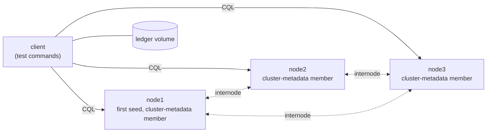

# Apache Cassandra 6.0-alpha2 with Accord under Antithesis: three new defects, two of them breaking strict serializability

**Prepared for:** the Apache Cassandra Accord developers · **Tested:** 8–9 October 2026 · **System:** Apache Cassandra cassandra-6.0-alpha2 ([`e874e3a9`][c-commit]) with Accord ([`fff32de2`][a-commit])

## Summary

We tested Accord transactions in Apache Cassandra 6.0-alpha2, the newest Cassandra release that
ships Accord, for about 42 hours of test runs under network faults, node pauses, CPU throttling,
node kills and clock jumps. Antithesis found three new defects. Two break Accord's headline
promise that transactions behave as if they ran one at a time, in real-time order (strict
serializability): [an acknowledged transfer is overwritten, and the bank total stops adding
up](#acked-transfer-overwritten), first seen 238.7 s into the simulation of the first 30-minute
run, with network faults alone; and [committed rows are read as absent](#committed-rows-read-absent). Both recur
in runs without node kills and under Cassandra's safe restart setting. The third is a
crash-recovery defect: [a node killed during an Accord journal append can never
restart](#journal-unreadable-after-kill), under every restart policy Cassandra offers. Our patch
for it let a node in the same state get through journal replay; the first two are only partly
root-caused, and our patches for them did not work. With the documented safe restart setting, the
checks that acknowledged writes survive crashes ([Guarantee 3](#guarantee-3)), that a
transaction's writes appear together ([Guarantee 2](#guarantee-2)) and that plain CQL is
linearizable ([Guarantee 4](#guarantee-4)) all passed over five hours with node kills.

## What we tested

- **The Accord developers' system:** Accord gives Apache Cassandra general multi-row, multi-table
  transactions (`BEGIN TRANSACTION … COMMIT TRANSACTION`) with strict serializability. It has no
  fixed leader: any node can coordinate a transaction, and if the coordinator dies, any other node
  can finish its work (recovery). It's developed as a library
  ([apache/cassandra-accord](https://github.com/apache/cassandra-accord)) and ships only inside
  Cassandra, pinned as the `modules/accord` submodule.
- **Under test:** Apache Cassandra cassandra-6.0-alpha2 ([`e874e3a9`][c-commit]) with its Accord
  submodule at [`fff32de2`][a-commit], because Accord has no release of its own: users only get it
  inside Cassandra, and 6.0-alpha2 is the newest release that ships it. Its Accord commit
  contains every Accord fix up to CASSANDRA-21440. A three-node 6.0-alpha2 cluster runs the exact
  Accord code the committers ship (coordination, recovery, the journal, per-key dependency
  tracking, durability scheduling), inside the integration they maintain.
- **How long:** 16 test runs, from a 5-minute setup check to 6-hour long runs, about 42 hours of
  testing in total, on 8 and 9 October 2026.

## Guarantees

The promises Cassandra with Accord makes to the applications that use it, in plain terms.

| Guarantee | Statement | Source | Result on 6.0-alpha2 |
|---|---|---|---|
| [Guarantee 1](#guarantee-1) | Transactions across several partitions and tables behave as if they ran one at a time, in an order that respects real time (strict serializability) | [transactions.adoc][doc-txn] | ❌ broken: [acknowledged transfer overwritten](#acked-transfer-overwritten), [committed rows read as absent](#committed-rows-read-absent) |
| [Guarantee 2](#guarantee-2) | All writes of one transaction become visible together, or not at all (atomic commitment) | [transactions.adoc][doc-txn] | ❌ its checks failed, but only as [committed rows read as absent](#committed-rows-read-absent) (one row of a group read as absent), or after restarts under our unsafe restart setting. No group ever showed two different tokens. With the safe restart setting, every check passed |
| [Guarantee 3](#guarantee-3) | A transaction acknowledged to the client survives a crash and restart of a minority of replicas (durability) | [transactions.adoc][doc-txn] | ✅ held with the safe restart setting and node kills, and in every run without node kills. It failed only under our unsafe restart setting ([Scope and limits](#scope-and-limits)) |
| [Guarantee 4](#guarantee-4) | On a `transactional_mode='full'` table, ordinary single-statement CQL reads and writes are linearizable | [transactions.adoc][doc-txn], [onboarding-to-accord.adoc][doc-onboard] | ✅ held in 11 of the 14 runs that tested it, including the safe-restart run. It failed only with node kills under our unsafe restart setting |
| [Guarantee 5](#guarantee-5) | Once failures stop, a transaction succeeds again within 120 s (availability after recovery; the window is our inference) | [CEP-15][cep15] | ❌ broken: [a killed node can never restart](#journal-unreadable-after-kill). Held in every run without node kills |

### Guarantee 1: transactions behave as if run one at a time, in real-time order

"Strict Serializability: Transactions execute as if in a single, total order that respects
real-time ordering" ([transactions.adoc][doc-txn]). The tests run bank transfers between 12
accounts in two tables, and read-only audits of all of them. Every consistent snapshot must sum to
the initial total, and a transaction that starts after another was acknowledged must see it
([test commands](#test-commands)).

### Guarantee 2: a transaction's writes are visible together, or not at all

"Atomic Commitment: All changes commit together or none at all" ([transactions.adoc][doc-txn]).
Each write puts one fresh token into 2–4 rows across two tables; every read must see the same token
in all of them, or none.

### Guarantee 3: acknowledged writes survive crashes

"Durable Writes: Committed transactions survive node failures" ([transactions.adoc][doc-txn]). The
tests record every acknowledged write in a ledger and read each one back, during faults and after
they stop.

### Guarantee 4: plain CQL on full-mode tables is linearizable

"Normal CQL reads and writes become linearizable when `transactional_mode='full'`"
([transactions.adoc][doc-txn]; [onboarding-to-accord.adoc][doc-onboard]). Single-writer version
counters are written and read with plain CQL; a read that starts after a write was acknowledged
must return that version or a newer one, through any coordinator.

### Guarantee 5: the cluster recovers after faults stop

CEP-15: "latency and performance should be unaffected by any minority of replica failures"
([CEP-15][cep15]). After faults stop, a probe retries a small transaction through each node for
120 s. Cassandra documents no recovery time, so the 120 s window is our inference.

## How we tested

### Environment

*Four containers on one network with fixed addresses. Solid arrows: client requests over
Cassandra's query protocol (CQL), spread over all three nodes. Dotted arrows: node-to-node traffic
(Accord messages, the cluster-metadata log, gossip). The cylinder is a shared volume holding the
client's record of acknowledged writes, so it survives client restarts. Every key is stored on all
three nodes (replication factor 3), so any two nodes form a majority (quorum).*

- **Software under test:**
  - **Apache Cassandra** cassandra-6.0-alpha2: [`e874e3a9`][c-commit] ([apache/cassandra](https://github.com/apache/cassandra)).
  - **Accord**, Cassandra's `modules/accord` submodule at that commit: [`fff32de2`][a-commit] ([apache/cassandra-accord](https://github.com/apache/cassandra-accord)), built as part of the Cassandra build.
  - Built from source ([Dockerfile](antithesis/Dockerfile)) with Antithesis's coverage
    instrumentation over the Cassandra and Accord jars (163,547 code locations). Every build that
    ran is listed in [Builds](#builds).
- **Faults:** Antithesis deliberately disrupted the system during the test (fault injection).
  - Every run: network partitions, slowdowns and clogs between all containers.
  - Most runs: also node pauses, CPU throttling, node kills and graceful stops with restart, and
    clock jumps. Two long runs left out node kills, to separate their effects.
  - The long runs used Antithesis's faster performance tier.
- **Workload** (Python, `cassandra-driver` 3.30.1):
  - bank transfers and audits over 12 accounts in two tables, plus private two-account transfers
    with real-time markers ([Guarantee 1](#guarantee-1));
  - token writes to groups of 2–4 rows across two tables, and readers of those groups
    ([Guarantee 2](#guarantee-2));
  - uniquely identified writes recorded in a ledger and read back during and after faults
    ([Guarantee 3](#guarantee-3));
  - single-writer version registers written and read with plain CQL ([Guarantee 4](#guarantee-4));
  - requests sent both once with an explicit outcome and the way applications send them, with the
    driver's silent retries and their own resubmits.

**How the tested setup differs from a default install** (applied in
[cassandra-overrides.yaml](antithesis/sut/cassandra-overrides.yaml)):

| Setting | Test value | Production default | Why |
|---|---|---|---|
| `accord.shard_durability_cycle` / `global_durability_cycle` | 20s / 20s | 5m / 5m | durability rounds, which advance garbage-collection bounds, run many times per run (the project's own tests use 20s) |
| `accord.shard_durability_target_splits` | 4 | 8 | durability rounds finish quickly on a small dataset (project test value) |
| `accord.retry_syncpoint` / `retry_durability` | `1s*attempts` | `10s*attempt <= 600s` | retries on the timescale of the faults (project test value) |
| `accord.expire_syncpoint` | `1s*attempts<=300s` | `60s*attempts<=300s` | stuck synchronization points expire on the fault timescale |
| `accord.recover_txn` | `1s*attempts <= 10s` | `5s*attempts <= 60s` | recovery of stalled transactions starts sooner, including recovery racing a live coordinator |
| `accord.command_store_shard_count` / `queue_shard_count` | 2 / 2 | number of cores | fewer internal shards, so more transactions contend on each (project test value) |
| `accord.journal.segment_size` | 1 MiB | 32 MiB | journal segments roll over and are compacted often. **This makes [the journal finding](#journal-unreadable-after-kill) more frequent:** a larger segment changes how often a kill lands in an append, not whether it can |
| `accord.journal.compaction_period` | 10000ms | 60000ms | journal compaction every few seconds |
| `accord.journal.flush_mode` / `commitlog_sync` | PERIODIC / periodic | same | kept at the defaults. One long run forced both to sync every write (`BATCH` / `batch`) |
| `accord.journal.stop_marker_failure_policy` | `ALLOW_UNSAFE_STARTUP`; `REBOOTSTRAP` in one long run | `EXIT` | with the default, a node killed without a clean stop refuses to start, so every kill would be a permanent node loss. **Cassandra documents our value as "VERY UNSAFE"**, and it produced failures we don't count: see [Scope and limits](#scope-and-limits) |
| `memtable_heap_space` | 16MiB | ¼ heap | frequent flushes, so reads merge memory and disk |
| `commitlog_segment_size` | 5MiB | 32MiB | commit-log segments roll over and recycle |
| `num_tokens` | 1 | 16 | a simple ring, as in the project's own Accord tests |
| `write_request_timeout` / `read_request_timeout` / `native_transport_timeout` | 10s / 10s / 30s | 2s in code (10s in the shipped yaml) / 5s / 12s | transaction deadlines the project's tests also raise |
| `MAX_HEAP_SIZE` | 1536M | ½ RAM, capped | bounded memory, so Accord's cache evicts and reloads from the journal |

Other choices: fixed container addresses (a restarted container otherwise came back under a new
address, which the cluster-metadata service keys members by); all three nodes listed as seeds on
restart ([entrypoint.sh](antithesis/sut/entrypoint.sh)); the cluster-metadata service grown to 3
members during setup ([helper-cms-bootstrap.sh](antithesis/sut/helper-cms-bootstrap.sh)); and
logging at INFO instead of DEBUG ([logback.xml](antithesis/sut/logback.xml)).

### Test commands

The workload has 15 test commands: 9 drivers that run at random times while Antithesis injects
faults, 2 checkers that run during faults, and 4 that check after faults stop. **How each one
works, every check it makes, and where in the code: [How the tests work](speedrun-tests.md).**

| Guarantee | What the commands do | Commands |
|---|---|---|
| [Guarantee 1](#guarantee-1) | Bank transfers between 12 accounts, some sent once with an explicit outcome and some the way applications send them, plus transfers in private account pairs. Every audit must sum to the initial total with an even counter sum, and every read that starts after an acknowledged transfer must see it | [`parallel_driver_bank_transfers`](speedrun-tests.md#parallel_driver_bank_transfers), [`parallel_driver_bank_autoretry`](speedrun-tests.md#parallel_driver_bank_autoretry), [`parallel_driver_rt_marker`](speedrun-tests.md#parallel_driver_rt_marker), [`anytime_bank_audit`](speedrun-tests.md#anytime_bank_audit), [`eventually_bank_audit`](speedrun-tests.md#eventually_bank_audit) |
| [Guarantee 2](#guarantee-2) | One token written to every row of a group, with plain and conditional transactions and logged batches. Every read must see one token in all rows, or none | [`parallel_driver_pair_writes`](speedrun-tests.md#parallel_driver_pair_writes), [`parallel_driver_pair_reads`](speedrun-tests.md#parallel_driver_pair_reads), [`eventually_pair_check`](speedrun-tests.md#eventually_pair_check) |
| [Guarantee 3](#guarantee-3) | Uniquely identified writes recorded in a ledger. Every acknowledged write must be present with its value, during faults and after | [`parallel_driver_durable_writes`](speedrun-tests.md#parallel_driver_durable_writes), [`parallel_driver_durable_readback`](speedrun-tests.md#parallel_driver_durable_readback), [`anytime_durable_sample`](speedrun-tests.md#anytime_durable_sample), [`eventually_durable_check`](speedrun-tests.md#eventually_durable_check) |
| [Guarantee 4](#guarantee-4) | Single-writer registers written and read with plain CQL through varying coordinators. A read must return the latest acknowledged version or a newer one, and never go backwards | [`parallel_driver_fm_register`](speedrun-tests.md#parallel_driver_fm_register), [`parallel_driver_fm_readers`](speedrun-tests.md#parallel_driver_fm_readers) |
| [Guarantee 5](#guarantee-5) | After faults stop, a small transaction through each node, and a plain write and read, must succeed within 120 s | [`eventually_recovery_probe`](speedrun-tests.md#eventually_recovery_probe) |

Before any command runs, [`client_setup`](speedrun-tests.md#client_setup) creates the keyspace and
full-mode tables, checks a transaction through every node, and seeds the bank. Antithesis's own
default checks, such as "no unexpected container exits", also run.

## Known-bug check

To show the tests can catch a real bug of this kind, we picked a fixed historical one:
[CASSANDRA-21440](https://issues.apache.org/jira/browse/CASSANDRA-21440), "Expunged records may be
resurrected". A replica could load a transaction whose records had been garbage-collected from the
Accord journal as "never seen" instead of "erased", which "can lead to linearizability
violations". It breaks [Guarantee 1](#guarantee-1). We built the version from before the fix:
Cassandra [`c9ffe116`][c-prefix] (Accord [`0a10cd05`][a-prefix]), the parent of fix
[`3d40c882`][c-fix] (Accord [`66cab49f`][a-fix]).

**The check wasn't needed, so it wasn't run.** Before it would have run, the same Guarantee 1
checks had already caught [an acknowledged transfer being overwritten](#acked-transfer-overwritten)
on the current release, which shows they work on a real bug. Not reproduced, because not run.

## Findings

Each finding was reviewed independently by someone whose job was to explain it as an artefact of
our test setup; none could be. Ordered by severity.

### An acknowledged transfer is overwritten, and the bank total stops adding up

**Full analysis:** [root cause](antithesis/scratchbook/rca/acked-transfer-overwritten.md) · **Patch tried (did not fix it):** [acked-transfer-overwritten.patch](antithesis/fixes/acked-transfer-overwritten.patch)

- **What broke:** read-only audits saw bank totals of 11,992, 11,938 and 12,144 instead of 12,000,
  and odd transfer-counter sums, which no set of whole transfers can produce. A credit that had
  been acknowledged to the client was missing from a later transaction and appeared afterwards.
  The bad state was stored: separate client processes read it through different coordinators,
  including audits that send each request once.
- **Guarantee:** [Guarantee 1](#guarantee-1), "transactions behave as if they ran one at a time,
  in an order that respects real time".
- **Impact:** money is created or destroyed in exactly the multi-partition-transfer use case the
  docs advertise. An acknowledged commit can be partly undone by a concurrent transaction (a lost
  update), with no error raised.
- **How it happened:**
  1. Network partitions delay messages; a fast-path reconfiguration creates a new epoch.
  2. A transfer of 144 is acknowledged after 3 attempts.
  3. A transfer of 13 between the same accounts reads that effect and is acknowledged.
  4. A second execution of the 13 transfer reads the accounts as they were before the 144 transfer, and stores writes
     computed from that stale read.
  5. Both of its write sets are stored; the stale one wins on each key for a while, so the 144 transfer's
     effect is lost and the total no longer adds up.
- **Seen in:** the first 30-minute run ([`e4947374`][r-e4947374]), with network faults only: first
  at vtime 238.69 ([log][l-xfer-a]), found while the run was in progress. The bank-total check
  failed in 13 of the 15 runs that tested it, including both long runs without node kills (1,747
  times in [`1d499fea`][r-1d499fea], 1,447 in [`2accaa07`][r-2accaa07]) and the run with the safe
  restart setting (95 in [`0458bd36`][r-0458bd36]).
- **Root cause (partial):** Cassandra acknowledges the client before it sends `Apply`
  ([`CoordinationAdapter.java:291`][a-coordadapter-291]). With Cassandra's default
  `MAY_BYPASS_SAFESTORE` ([`AccordService.java:282-288`][c-accordservice-282]), a fast-path
  transaction's read and late `Apply` messages bypass the per-command state checks, and `Apply`
  writes storage before the race with recovery is detected
  ([`Commands.java:631`][a-commands-631]); recovery meanwhile re-executes and stores its own writes.
  Two different write sets for one transaction can only come from two executions with different
  reads. Why the second read missed the earlier transfer is not established: the fast-read bypass reading
  a stale snapshot, or recovery rebuilding dependencies without it.
- **Proposed fix:** switching the fast execution default to Accord's own `MAY_BYPASS_COMMANDSFORKEY`
  (plus a fix for a secondary crash on a failed read) **did not prevent it**: a build with it, and
  a second patch that never activated, failed the bank total 38 times in 30 minutes. A complete fix needs the second execution identified first.
  [How it was checked](antithesis/scratchbook/rca/acked-transfer-overwritten.md#fix).
- **Already known upstream?** No matching report. The code paths are unchanged on trunk, from
  reading. The secondary crash is fixed on trunk, as a side change in
  [CASSANDRA-21662](https://issues.apache.org/jira/browse/CASSANDRA-21662).

### Committed rows are read as absent

**Full analysis:** [root cause](antithesis/scratchbook/rca/committed-rows-read-absent.md) · **Diagnostic patch (not a fix):** [committed-rows-read-absent.patch](antithesis/fixes/committed-rows-read-absent.patch)

- **What broke:** read transactions returned "no row" for accounts that were seeded in one
  transaction before testing started and that earlier transactions had read normally. Nothing in
  the workload deletes rows or writes nulls. One audit lost 7 of 12 rows at once, and the same 7
  went missing in another run. In the [Guarantee 2](#guarantee-2) checks, the same shape appears as
  one row of a group read as absent while the others hold the token.
- **Guarantee:** [Guarantee 1](#guarantee-1).
- **Impact:** a transaction can decide based on data that seems not to exist: an `IF row IS NULL`
  branch can fire for a row that is there, or a read can return partial results with no error.
- **How it happened:**
  1. The seed transaction commits; audits see all 12 rows.
  2. Network faults run; durability and journal-compaction rounds run on the coordinator.
  3. A read transaction is coordinated by a node that, holding every key, reads locally.
  4. Only the rows of the node's first internal shard (command store) come back; the others are
     dropped without being reported unavailable, so they read as absent.
- **Seen in:** 4 independent occurrences in 3 shorter runs, with three different coordinators,
  first at vtime 155.44 in [`83ddaf62`][r-83ddaf62] ([log][l-rows-83dd]). "Every seeded bank
  account is visible" failed in 9 runs, including both long runs without node kills (44 times in
  [`1d499fea`][r-1d499fea], 47 in [`2accaa07`][r-2accaa07]) and the run with the safe restart
  setting (5 in [`0458bd36`][r-0458bd36]).
- **Root cause (partial):** the missing set is exactly "every command store except store 0",
  computed from the keys' Murmur3 tokens and the store-to-range split in the server's logs, which
  explains why the same 7 rows went missing twice. The coordinator executes locally
  ([`ExecuteTxn.java:231`][a-executetxn-231]) and a local reply with nothing marked unavailable is
  approved for every shard ([`ReadTracker.java:88`][a-readtracker-88]). The faulty line is not
  established: the two replica-side paths we suspected were ruled out.
- **Proposed fix:** none yet. A diagnostic patch that reports unread keys as unavailable never
  fired, while rows were still read as absent, so the loss happens after the replica's reply or in
  the data read itself. [How it was checked](antithesis/scratchbook/rca/committed-rows-read-absent.md#fix).
- **Already known upstream?** No matching report. Probably still present on trunk: the code paths
  are unchanged, but without the faulty line this is a reading check only.

### A node killed during an Accord journal append can never restart

**Full analysis:** [root cause](antithesis/scratchbook/rca/journal-unreadable-after-kill.md) · **Proposed fix:** [journal-unreadable-after-kill.patch](antithesis/fixes/journal-unreadable-after-kill.patch)

- **What broke:** Antithesis killed node2 (SIGKILL) at vtime 217.58. On restart, Cassandra
  replayed its commit log, then failed to open the Accord journal with
  `JournalReadError … Crc$InvalidCrc: Read 0` and exited with code 3. Every later restart failed the
  same way.
- **Guarantee:** [Guarantee 5](#guarantee-5), and the minority-failure tolerance it rests on.
- **Impact:** a routine process crash (an out-of-memory kill, `kill -9`, a container eviction) at
  the wrong instant makes a node unrecoverable without deleting journal files by hand, which loses
  the Accord state the journal exists to protect. `REBOOTSTRAP`, Cassandra's documented recovery
  after an unclean stop, opens the journal first and fails the same way. The only way out is the
  undocumented `crc_failure_on_rebuild_policy`, which defaults to `FAIL`. With one node gone for
  good, any further fault leaves the cluster without a majority.
- **How it happened:**
  1. The journal appends an entry in two steps: it reserves space by writing the length, then
     writes the body and, last, the checksums.
  2. The kill lands between the two, leaving a valid length and a zero checksum in the segment
     that was active.
  3. On restart, that segment has no metadata file, so the journal rebuilds it by scanning, treating
     the whole file as synced to disk.
  4. The zero checksum is taken for corruption, and the default policy aborts startup, every time.
- **Seen in:** the longest run ([`c16f5775`][r-c16f5775], 6 hours), by Antithesis's default
  container-exit check: 45 failing examples, all from this one event, first at vtime 224.19
  ([log][l-journal-c16f]). The same failure happened in all three long runs with node kills and the
  default test configuration (on node3 in [`42229a5d`][r-42229a5d] and [`a0534fbf`][r-a0534fbf]).
- **Root cause:** `Metadata.rebuild` scans with the synced limit set to `Integer.MAX_VALUE`
  ([`Metadata.java:140`][c-metadata-140]), so it can't tell an unfinished, never-acknowledged tail
  from real corruption, and the default `FAIL` policy
  ([`AccordConfig.java:399`][c-accordconfig-399]) throws from
  [`StaticSegment.java:462`][c-staticsegment-462]. The metadata is never written, so every restart
  repeats the scan. The on-disk bytes, reconstructed from the logged checksum, are exactly a length
  marker followed by an unwritten entry.
- **Proposed fix:** only for a segment with no metadata file, treat the first entry with a valid
  length and a zero checksum as the end of the segment, and persist that position; everything else
  stays fatal. **Verified, with a caveat:** in a 2-hour check the same torn entry recurred, the patch
  handled it, the node went through journal replay, and there were no journal-error exits (45 in the
  run that found it). The examined branch ended before "Startup complete".
  [How it was checked](antithesis/scratchbook/rca/journal-unreadable-after-kill.md#fix).
- **Already known upstream?** Not as a bug.
  [CASSANDRA-21355](https://issues.apache.org/jira/browse/CASSANDRA-21355) added an opt-in
  `IGNORE_CRC_ZERO_RECORDS` policy for this zero-checksum case, but it applies to every rebuild,
  isn't in `cassandra.yaml` or the docs, and the default stays `FAIL`. The journal code is
  byte-identical on trunk, from reading.

## Scope and limits

- **Our restart setting caused failures we don't count.** To let killed nodes restart, we set
  `accord.journal.stop_marker_failure_policy` to `ALLOW_UNSAFE_STARTUP`, which Cassandra documents
  as "VERY UNSAFE". Accord applies transaction writes without the commit log and relies on journal
  replay after a crash, which is trustworthy only after a clean stop. Under this setting, runs with
  node kills reported lost acknowledged writes, stale register reads and groups with missing rows
  ([Guarantees 2](#guarantee-2), [3](#guarantee-3) and [4](#guarantee-4)). Two runs separated the
  causes: forcing every write to disk didn't stop them ([`823089f6`][r-823089f6]), and with the
  documented safe setting, `REBOOTSTRAP`, every check of those three guarantees passed over five
  hours of node kills ([`0458bd36`][r-0458bd36]). Those failures are not counted as findings. Only
  one run used the safe setting.
- **The Guarantee 5 window is shorter than Cassandra's own bound.** Cassandra lets a restarting
  node catch up for up to 900 s (`catchup_on_start_fail_latency`); our window was 120 s. Apart from
  [the journal finding](#journal-unreadable-after-kill), Guarantee 5 failures after node restarts
  are not counted. With `REBOOTSTRAP`, transactions often failed for more than 120 s after faults
  stopped, which this window can't judge.
- **Faults beyond the promise were excluded.** In one history of the journal finding, all three
  nodes were killed within 17.5 s; the cluster-wide outage that followed goes beyond the
  minority-failure promise and is not counted.
- **Tuned settings change frequency, not behaviour.** The 1 MiB journal segments and the 1 s
  recovery delay make journal rollovers and recovery races more frequent than at the defaults; how
  much they change the rate of the two Guarantee 1 findings wasn't measured.
- **The known-bug check wasn't run** ([Known-bug check](#known-bug-check)).
- **The upstream comparisons** read Cassandra trunk at [`36d2433d`][c-trunk] (Accord
  [`56b7710a`][a-trunk]); trunk wasn't built or tested.

## Appendix

### Runs

Every run that contributed to these results. Report links carry an access token: anyone with the
link can open the report. Log links open the Antithesis logs explorer at the failing moment, and
need a login to the tenant.

| Run | Purpose | Build | Length | Result |
|---|---|---|---|---|
| [`d86774c9`][r-d86774c9] | setup check: the system boots; network faults | [current](#builds) | 5 min | passed: all properties pass, instrumentation confirmed |
| [`e4947374`][r-e4947374] | test iteration: Guarantee 1 commands; network faults | [current](#builds) | 30 min | found [the overwritten transfer](#acked-transfer-overwritten) while running; [rows read as absent](#committed-rows-read-absent) also seen |
| [`83ddaf62`][r-83ddaf62] | test iteration: all five guarantees; network faults | [current](#builds) | 30 min | Guarantee 1 fails (both findings); Guarantees 2–5 held |
| [`0b77f2b9`][r-0b77f2b9] | fix check: [the overwritten transfer](#acked-transfer-overwritten); network faults | [fix check](#builds) | 30 min | bank total passed 682 of 682; rows still read as absent |
| [`126cbacd`][r-126cbacd] | test iteration: all fault types | [current](#builds) | 30 min | three problems in our test setup, fixed; one Guarantee 2 failure in the [rows-absent](#committed-rows-read-absent) shape |
| [`0e194950`][r-0e194950] | fix check: [the overwritten transfer](#acked-transfer-overwritten); all fault types | [fix check](#builds) | 30 min | the same test-setup problems; one bank-total failure right after its coordinator restarted |
| [`ccc9549e`][r-ccc9549e] | fix check: [rows read as absent](#committed-rows-read-absent), on top of the transfer patch; network faults | [fix check](#builds) | 30 min | both patches failed: bank total failed 38 times, rows read as absent 3 times |
| [`d59511b5`][r-d59511b5] | test iteration: all fault types, after the test-setup fixes | [current](#builds) | 30 min | only [the overwritten transfer](#acked-transfer-overwritten) (3) |
| [`42229a5d`][r-42229a5d] | long run: all fault types | [current](#builds) | 300 min | both Guarantee 1 findings; [the journal finding](#journal-unreadable-after-kill) on node3; other failures under our restart setting |
| [`a0534fbf`][r-a0534fbf] | long run: all fault types except clock jumps | [current](#builds) | 300 min | both Guarantee 1 findings; [the journal finding](#journal-unreadable-after-kill) on node3; Guarantee 4 held |
| [`c16f5775`][r-c16f5775] | long run: all fault types | [current](#builds) | 360 min | found [the journal finding](#journal-unreadable-after-kill) (45 examples); both Guarantee 1 findings |
| [`1d499fea`][r-1d499fea] | long run: no node kills or clock jumps | [current](#builds) | 300 min | [overwritten transfer](#acked-transfer-overwritten) (1,747), [rows absent](#committed-rows-read-absent) (44); Guarantees 3, 4, 5 held |
| [`823089f6`][r-823089f6] | long run: every write forced to disk; all fault types | [every write synced](#builds) | 300 min | acknowledged writes still lost under our restart setting, so it wasn't unsynced data; [overwritten transfer](#acked-transfer-overwritten) |
| [`0458bd36`][r-0458bd36] | long run: the documented safe restart setting; all fault types | [safe restart](#builds) | 300 min | Guarantees 2, 3, 4 held with node kills; both Guarantee 1 findings |
| [`2accaa07`][r-2accaa07] | long run: no node kills, with clock jumps | [current](#builds) | 300 min | [overwritten transfer](#acked-transfer-overwritten) (1,447), [rows absent](#committed-rows-read-absent) (47); Guarantees 3, 4, 5 held |
| [`72728337`][r-72728337] | fix check: [the journal finding](#journal-unreadable-after-kill); all fault types | [fix check](#builds) | 120 min | verified, with a caveat: no journal-error exits (45 in the run that found it) |

### Builds

Every build uses [antithesis/Dockerfile](antithesis/Dockerfile); builds differ only in the
source commit, the patch directory and the configuration variant. All Cassandra builds carry the
Antithesis SDK dependency and one "startup complete" marker
([patches/common/](antithesis/patches/common/)).

| Build | Component | Repository | Version | Commit | Changes on top |
|---|---|---|---|---|---|
| current | Apache Cassandra | [apache/cassandra](https://github.com/apache/cassandra) | cassandra-6.0-alpha2 | [`e874e3a9`][c-commit] | SDK dependency and marker only ([config](antithesis/config/)) |
| current | Accord | [apache/cassandra-accord](https://github.com/apache/cassandra-accord) | submodule of the above | [`fff32de2`][a-commit] | none |
| every write synced | Cassandra + Accord | same | current, configuration only | [`e874e3a9`][c-commit] | commit log and journal sync every write ([durable.sed](antithesis/sut/variants/durable.sed), [config](antithesis/config-hunt-durable/)) |
| safe restart | Cassandra + Accord | same | current, configuration only | [`e874e3a9`][c-commit] | restart policy `REBOOTSTRAP` ([rebootstrap.sed](antithesis/sut/variants/rebootstrap.sed), [config](antithesis/config-hunt-rebootstrap/)) |
| before the fix (built, not run) | Apache Cassandra | same | parent of fix [`3d40c882`][c-fix] | [`c9ffe116`][c-prefix] | SDK dependency and marker ([override](antithesis/config/compose.prefix.override.yaml)) |
| before the fix (built, not run) | Accord | same | submodule of the above (fix [`66cab49f`][a-fix]) | [`0a10cd05`][a-prefix] | none |
| fix check: overwritten transfer | Cassandra + Accord | same | current + proposed fix | [`e874e3a9`][c-commit] | [transfer patch](antithesis/fixes/acked-transfer-overwritten.patch) ([config](antithesis/config-fixverify-acked-transfer-overwritten/)) |
| fix check: rows read as absent | Cassandra + Accord | same | current + two patches | [`e874e3a9`][c-commit] | [transfer patch](antithesis/fixes/acked-transfer-overwritten.patch) + [diagnostic patch](antithesis/fixes/committed-rows-read-absent.patch) ([config](antithesis/config-fixverify-committed-rows-read-absent/)) |
| fix check: journal | Cassandra + Accord | same | current + proposed fix | [`e874e3a9`][c-commit] | [journal patch](antithesis/fixes/journal-unreadable-after-kill.patch) ([config](antithesis/config-fixverify-journal-unreadable-after-kill/)) |

Released components used as-is:
- **Build images:** `eclipse-temurin:11-jdk@sha256:8db2bcf62ae171d1247c331db0410d8bc6347e7493bdafe104bb9a33d59c1291` (toolchain, with Apache Ant 1.10.14) and `eclipse-temurin:11-jre@sha256:ad419849e59e2c7a325078dff5eb64db6f61c8872e316dfd501031ed72efc2dd` (runtime).
- **Cassandra image as built (current):** registry digest `sha256:6ab2501f53aaca0c84a6f459d214e8c115ed57cf233822b98d4e2a326c18e98d`.
- **Test client image:** based on `python:3.11-slim-bookworm` (base digest not recorded), with `cassandra-driver==3.30.1` and the Antithesis Python SDK `antithesis==0.4.0` ([requirements.txt](antithesis/test/requirements.txt)); the long runs and the journal fix check used registry digest `sha256:e9a5611c014ac3857ced58750a3f6f41c78e9cd46a8b105e71a0ae2de051f69b`.
- **Coverage and SDK:** the Antithesis Java SDK `com.antithesis:sdk` and `com.antithesis:ffi` 1.7.0 from Maven Central.

[c-commit]: https://github.com/apache/cassandra/commit/e874e3a90b1942b945477e6d9ba03880b4f4a19d
[a-commit]: https://github.com/apache/cassandra-accord/commit/fff32de2e915772fbc70d16b1c32346313877838
[c-prefix]: https://github.com/apache/cassandra/commit/c9ffe116457384200851939e3687f81c00015e02
[c-fix]: https://github.com/apache/cassandra/commit/3d40c8825c8b06bcbd8378d698f6d2f3bf5dc25e
[a-prefix]: https://github.com/apache/cassandra-accord/commit/0a10cd056794c05588114f45ce86d49d6d6538db
[a-fix]: https://github.com/apache/cassandra-accord/commit/66cab49f1c9af471795339a5fdf9522e6e73b691
[c-trunk]: https://github.com/apache/cassandra/commit/36d2433dfb2fd26fb8719716edf1b5f3232df8d3
[a-trunk]: https://github.com/apache/cassandra-accord/commit/56b7710afaf3ac1492e50669f8ef5c0985654586
[doc-txn]: https://github.com/apache/cassandra/blob/trunk/doc/modules/cassandra/pages/developing/cql/transactions.adoc
[doc-onboard]: https://github.com/apache/cassandra/blob/cassandra-6.0-alpha2/doc/modules/cassandra/pages/managing/operating/onboarding-to-accord.adoc
[cep15]: https://cwiki.apache.org/confluence/display/CASSANDRA/CEP-15%3A+General+Purpose+Transactions
[a-coordadapter-291]: https://github.com/apache/cassandra-accord/blob/fff32de2e915772fbc70d16b1c32346313877838/accord-core/src/main/java/accord/coordinate/CoordinationAdapter.java#L291
[c-accordservice-282]: https://github.com/apache/cassandra/blob/e874e3a90b1942b945477e6d9ba03880b4f4a19d/src/java/org/apache/cassandra/service/accord/AccordService.java#L282-L288
[a-commands-631]: https://github.com/apache/cassandra-accord/blob/fff32de2e915772fbc70d16b1c32346313877838/accord-core/src/main/java/accord/local/Commands.java#L631
[a-executetxn-231]: https://github.com/apache/cassandra-accord/blob/fff32de2e915772fbc70d16b1c32346313877838/accord-core/src/main/java/accord/coordinate/ExecuteTxn.java#L231
[a-readtracker-88]: https://github.com/apache/cassandra-accord/blob/fff32de2e915772fbc70d16b1c32346313877838/accord-core/src/main/java/accord/coordinate/tracking/ReadTracker.java#L88
[c-metadata-140]: https://github.com/apache/cassandra/blob/e874e3a90b1942b945477e6d9ba03880b4f4a19d/src/java/org/apache/cassandra/journal/Metadata.java#L140
[c-accordconfig-399]: https://github.com/apache/cassandra/blob/e874e3a90b1942b945477e6d9ba03880b4f4a19d/src/java/org/apache/cassandra/config/AccordConfig.java#L399
[c-staticsegment-462]: https://github.com/apache/cassandra/blob/e874e3a90b1942b945477e6d9ba03880b4f4a19d/src/java/org/apache/cassandra/journal/StaticSegment.java#L462

[r-e4947374]: https://honey-whale.antithesis.com/report/xrIBSxLwAHWhRf49AROCTaMK/yWwNglWJp3ThXiESihRapRCIs7Pwz7ROGJpTVNx0uxU.html?auth=v2.public.eyJuYmYiOiIyMDI2LTEwLTA4VDE1OjA4OjE1LjkyNDI3NDUzOFoiLCJzY29wZSI6eyJSZXBvcnRTY29wZVYxIjp7ImFzc2V0IjoieVd3TmdsV0pwM1RoWGlFU2loUmFwUkNJczdQd3o3Uk9HSnBUVk54MHV4VS5odG1sIiwicmVwb3J0X2lkIjoieHJJQlN4THdBSFdoUmY0OUFST0NUYU1LIn19fVe7MBHDdXkUUFSrjqed0PclvzX2NZKVJ5I8PaDlT0I1lpSuezQCi6_TaC8jVV1BULZeH7_RwR2JEBhNfVArCw4
[l-xfer-a]: https://honey-whale.antithesis.com/search?search=v6veyJxIjp7Im4iOnsiciI6eyJoIjpbeyJoIjpbeyJjIjoibW9tZW50LnZ0aW1lIiwiZiI6ImdlbmVyYWwuY3VzdG9tIiwibyI6Im1hdGNoZXMiLCJ2IjoiMjM4LjY5MjYwOTk1NTc4OTUyIn1dLCJvIjoib3IifSx7ImgiOlt7ImMiOiJtb21lbnQuaW5wdXRfaGFzaCIsImYiOiJnZW5lcmFsLmN1c3RvbSIsIm8iOiJtYXRjaGVzIiwidiI6IjMxMTU3MDcxMDk2Mjc4NjQwMTkifV0sIm8iOiJvciJ9XSwibyI6ImFuZCJ9LCJ0Ijp7ImciOmZhbHNlLCJtIjoiIn0sInkiOiJub25lIn19LCJzIjoiMzQ5OWQ0YTA4MTNhZjQ1MzE0NTMyMzNjNTc5Y2Y1OTMtNjMtMTIifQ
[r-1d499fea]: https://honey-whale.antithesis.com/report/fsuUPPeUhgYCGq2LvZsJZ8d_/h5mxMMzBbn64mgpOwAlUeWFw6Qz1sXSt8CC8So_UiDc.html?auth=v2.public.eyJuYmYiOiIyMDI2LTEwLTA5VDAwOjI0OjQ4LjM2MjY1ODEyM1oiLCJzY29wZSI6eyJSZXBvcnRTY29wZVYxIjp7ImFzc2V0IjoiaDVteE1NekJibjY0bWdwT3dBbFVlV0Z3NlF6MXNYU3Q4Q0M4U29fVWlEYy5odG1sIiwicmVwb3J0X2lkIjoiZnN1VVBQZVVoZ1lDR3EyTHZac0paOGRfIn19fXf3jvb122sZ-4y4nVBJTQcerBZo0DCvMeEV-7gJtIAYrllzdzZWaLw_Uw6xtClTY5HNIBY2xT7uaSGhz2pQEgc
[r-2accaa07]: https://honey-whale.antithesis.com/report/PsYGW6qkZ131C1VK_mXUshL3/eFLnc_1S4k4AJSeu1aN3MEMfL4KxOMEGfw6SimvT3S0.html?auth=v2.public.eyJuYmYiOiIyMDI2LTEwLTA5VDA2OjQyOjU5LjU1OTAxOTMzNloiLCJzY29wZSI6eyJSZXBvcnRTY29wZVYxIjp7ImFzc2V0IjoiZUZMbmNfMVM0azRBSlNldTFhTjNNRU1mTDRLeE9NRUdmdzZTaW12VDNTMC5odG1sIiwicmVwb3J0X2lkIjoiUHNZR1c2cWtaMTMxQzFWS19tWFVzaEwzIn19fbIJ5weDtJlHa4gRSSiCNm5OL60jdDJ_N4xHi0lkuzE7Xls_bk7ZgNYaX4BHmVptMDZUBCRFmCTWCUTany54pAY
[r-0458bd36]: https://honey-whale.antithesis.com/report/MzDTE5xeytiRYxlSU2QaPt3H/dQRasNugLBetHrdFh06kFBSzBkIjguaP46LjH0QqDAc.html?auth=v2.public.eyJzY29wZSI6eyJSZXBvcnRTY29wZVYxIjp7ImFzc2V0IjoiZFFSYXNOdWdMQmV0SHJkRmgwNmtGQlN6QmtJamd1YVA0NkxqSDBRcURBYy5odG1sIiwicmVwb3J0X2lkIjoiTXpEVEU1eGV5dGlSWXhsU1UyUWFQdDNIIn19LCJuYmYiOiIyMDI2LTEwLTA5VDA3OjIxOjA2LjI4NjY2NzM1NloiffvB0x3th9WM0CdvcM7LhpMEg3QFwjOaBmluWAcCpAG10eQn6HWe-NPcIauVmggv5jASS6txe5a4EzGcS8NNMAQ
[r-83ddaf62]: https://honey-whale.antithesis.com/report/2kEKMku2Ei7pS75t3iDKhVbx/j8fGuFgyCTLqn_ZYwhVR_WR9aLOJKc0MbEjI8xCgQpw.html?auth=v2.public.eyJuYmYiOiIyMDI2LTEwLTA4VDE2OjAyOjE1LjQzNjY0OTA1MVoiLCJzY29wZSI6eyJSZXBvcnRTY29wZVYxIjp7ImFzc2V0IjoiajhmR3VGZ3lDVExxbl9aWXdoVlJfV1I5YUxPSktjME1iRWpJOHhDZ1Fwdy5odG1sIiwicmVwb3J0X2lkIjoiMmtFS01rdTJFaTdwUzc1dDNpREtoVmJ4In19fUDXnp8uHRyAkW1TKXuyGEnf5ad6JXRwY8XbPjTPaWFDERrThAM_peYjzYhAFaUy6lhTRHwLZtnIwHTvA_ljagM
[l-rows-83dd]: https://honey-whale.antithesis.com/search?search=v6veyJxIjp7Im4iOnsiciI6eyJoIjpbeyJoIjpbeyJjIjoibW9tZW50LnZ0aW1lIiwiZiI6ImdlbmVyYWwuY3VzdG9tIiwibyI6Im1hdGNoZXMiLCJ2IjoiMTU1LjQzNjMzMDE3NDA5NTkzIn1dLCJvIjoib3IifSx7ImgiOlt7ImMiOiJtb21lbnQuaW5wdXRfaGFzaCIsImYiOiJnZW5lcmFsLmN1c3RvbSIsIm8iOiJtYXRjaGVzIiwidiI6Ii0zMzU5MjE3ODcwNDI3NjIwODY5In1dLCJvIjoib3IifV0sIm8iOiJhbmQifSwidCI6eyJnIjpmYWxzZSwibSI6IiJ9LCJ5Ijoibm9uZSJ9fSwicyI6IjQ1NjExMTQwOWIyZjIzZDhjNmJkZWJlNWEyZGRkMjQ3LTYzLTEyIn0
[r-c16f5775]: https://honey-whale.antithesis.com/report/xeFXBGscPgpTrEh3HgeiBn3r/ZXj-4QdSO3r-ImhAo-tFncJktsaXb_DSbBvEmgwtQGw.html?auth=v2.public.eyJuYmYiOiIyMDI2LTEwLTA5VDAxOjI4OjEzLjg5MzA2MDk0NVoiLCJzY29wZSI6eyJSZXBvcnRTY29wZVYxIjp7ImFzc2V0IjoiWlhqLTRRZFNPM3ItSW1oQW8tdEZuY0prdHNhWGJfRFNiQnZFbWd3dFFHdy5odG1sIiwicmVwb3J0X2lkIjoieGVGWEJHc2NQZ3BUckVoM0hnZWlCbjNyIn19fSdJ3KhdpBr-SnSTAwI4wfBSIzIOBLRhj70vJ-rqgY2vQBH3fQ21j3BM1XbZJNgZLDBQ_nC_jq4KZbpqZhE2kAU
[l-journal-c16f]: https://honey-whale.antithesis.com/search?search=v6veyJxIjp7Im4iOnsiciI6eyJoIjpbeyJoIjpbeyJjIjoibW9tZW50LnZ0aW1lIiwiZiI6ImdlbmVyYWwuY3VzdG9tIiwibyI6Im1hdGNoZXMiLCJ2IjoiMjI0LjcxMzc3NzIxMTk2MDQifV0sIm8iOiJvciJ9LHsiaCI6W3siYyI6Im1vbWVudC5pbnB1dF9oYXNoIiwiZiI6ImdlbmVyYWwuY3VzdG9tIiwibyI6Im1hdGNoZXMiLCJ2IjoiLTg1NDUyMzYzODg2MzkyMDA1MTMifV0sIm8iOiJvciJ9XSwibyI6ImFuZCJ9LCJ0Ijp7ImciOmZhbHNlLCJtIjoiIn0sInkiOiJub25lIn19LCJzIjoiN2U3MGYyOTc0NjI1NGM1MDRiM2Y4ZmRiYWEyYTk4MDEtNjMtMTIifQ
[r-42229a5d]: https://honey-whale.antithesis.com/report/NktZzXJr0UO579BjgdL5Mfs8/WahXSL5t4V92DlKQs1q_ypABQrL0eoB0t4m9lTR2aRQ.html?auth=v2.public.eyJuYmYiOiIyMDI2LTEwLTA5VDAwOjQ1OjUwLjE3MzY4NTQyNloiLCJzY29wZSI6eyJSZXBvcnRTY29wZVYxIjp7ImFzc2V0IjoiV2FoWFNMNXQ0VjkyRGxLUXMxcV95cEFCUXJMMGVvQjB0NG05bFRSMmFSUS5odG1sIiwicmVwb3J0X2lkIjoiTmt0WnpYSnIwVU81NzlCamdkTDVNZnM4In19fWrNFp5DNmFdjXAMDyLShAIiDFVbFBq3o-ivCj39i3X6r5xWrcK63PhPBBMfCW9XFdEfA-U-ykSWQds9ci3dMAE
[r-a0534fbf]: https://honey-whale.antithesis.com/report/Yrr8xPIhKvFwB5cxwbUjo71N/Tm3uCc675KWtl0XjMrwy-dUm6jzy_CBpF7n9t6Abiac.html?auth=v2.public.eyJzY29wZSI6eyJSZXBvcnRTY29wZVYxIjp7ImFzc2V0IjoiVG0zdUNjNjc1S1d0bDBYak1yd3ktZFVtNmp6eV9DQnBGN245dDZBYmlhYy5odG1sIiwicmVwb3J0X2lkIjoiWXJyOHhQSWhLdkZ3QjVjeHdiVWpvNzFOIn19LCJuYmYiOiIyMDI2LTEwLTA5VDAwOjUxOjEzLjYzNDE5NjA3NloifVZ8QpGpm__rQ6n-dlgWEtEZ7XGKnMDfCqEmwwxwDmgxYqPfOKeW-AW2lt_3S8p9YYsaHUvE6MqbNI69FpADSwI
[r-823089f6]: https://honey-whale.antithesis.com/report/BQ97m0_0OK6XKz1Uo5uogvqw/xeKj9Tctp8rQjonU4TtzS1-ajk1aoYGmCD7saKC6S6c.html?auth=v2.public.eyJzY29wZSI6eyJSZXBvcnRTY29wZVYxIjp7ImFzc2V0IjoieGVLajlUY3RwOHJRam9uVTRUdHpTMS1hamsxYW9ZR21DRDdzYUtDNlM2Yy5odG1sIiwicmVwb3J0X2lkIjoiQlE5N20wXzBPSzZYS3oxVW81dW9ndnF3In19LCJuYmYiOiIyMDI2LTEwLTA5VDA3OjIxOjM4LjQ3OTAzMDQ4OVoifTV_mFBRxwbmCrK8-5uma79uee2NV0C_p1bIMpmGQygC1Y6xRPuPaNcLfeoBHMJqlxDONOsQPDpPH1_vG9JvQws
[r-d86774c9]: https://honey-whale.antithesis.com/report/FxcyD1gLlrispQT5Won2yben/WduHcL8un39ZDuEa2B0dIzOIZQA3zIJp0faSH0wUcv4.html?auth=v2.public.eyJzY29wZSI6eyJSZXBvcnRTY29wZVYxIjp7ImFzc2V0IjoiV2R1SGNMOHVuMzlaRHVFYTJCMGRJek9JWlFBM3pJSnAwZmFTSDB3VWN2NC5odG1sIiwicmVwb3J0X2lkIjoiRnhjeUQxZ0xscmlzcFFUNVdvbjJ5YmVuIn19LCJuYmYiOiIyMDI2LTEwLTA4VDE0OjEyOjI4LjIyODUxOTMyOFoifburKuVu8fyGYu_Eu7kdTcQMFw8aOCQaFPJaZsIS1qId4pMOHplD6jykkOnWUNLtFryNFhvq5zcPHSclF_TfRQA
[r-0b77f2b9]: https://honey-whale.antithesis.com/report/IwjECCMMfn8ttNe3O2q6VpBk/y70rTIP4TaJV1syBnP0RWh6mhWeMzW2cVqkkqXDWRYA.html?auth=v2.public.eyJzY29wZSI6eyJSZXBvcnRTY29wZVYxIjp7ImFzc2V0IjoieTcwclRJUDRUYUpWMXN5Qm5QMFJXaDZtaFdlTXpXMmNWcWtrcVhEV1JZQS5odG1sIiwicmVwb3J0X2lkIjoiSXdqRUNDTU1mbjh0dE5lM08ycTZWcEJrIn19LCJuYmYiOiIyMDI2LTEwLTA4VDE2OjA0OjAwLjU0NTAzNzI4N1oifVgqM5p8JmpqTrJNfXkHe-u_7Wk_pfTWpvRceqnBiyttiopD_3bctLgkMbRlQc1q5E3EUWrASgjoGQxllwKrMwc
[r-126cbacd]: https://honey-whale.antithesis.com/report/zmTGhQqT5crjapLTREVHyQo1/n3y3NkFh_T7O71fouh6SAB89DacwGkLqFUeQBBl_wCo.html?auth=v2.public.eyJuYmYiOiIyMDI2LTEwLTA4VDE2OjUzOjMzLjk3NTkyMjEyNFoiLCJzY29wZSI6eyJSZXBvcnRTY29wZVYxIjp7ImFzc2V0IjoibjN5M05rRmhfVDdPNzFmb3VoNlNBQjg5RGFjd0drTHFGVWVRQkJsX3dDby5odG1sIiwicmVwb3J0X2lkIjoiem1UR2hRcVQ1Y3JqYXBMVFJFVkh5UW8xIn19fZ9r5g_OdCrQRJ1zvWuRLOwh7d9AV5C31dgO2snRuRecDcJHw4OVlwbwiP-DOd020EI0bf0g6QnVoq97K4lZmAk
[r-0e194950]: https://honey-whale.antithesis.com/report/1m1Ur9qEIU4qMIV6bVIJALEA/TZXCICByv8d1_9cYxLwOit-JGi3xkzPHbasNfHMMLcE.html?auth=v2.public.eyJuYmYiOiIyMDI2LTEwLTA4VDE2OjUzOjMzLjg0MzAwNTQ2MloiLCJzY29wZSI6eyJSZXBvcnRTY29wZVYxIjp7ImFzc2V0IjoiVFpYQ0lDQnl2OGQxXzljWXhMd09pdC1KR2kzeGt6UEhiYXNOZkhNTUxjRS5odG1sIiwicmVwb3J0X2lkIjoiMW0xVXI5cUVJVTRxTUlWNmJWSUpBTEVBIn19fYRMwrkd2H--hy32gsQF2UrB5cW93Y848VKOv1g5hnJSqlsgMIE2PmVkcLF8QqXEllbUn3BJk5KjacXN5k-TeQg
[r-ccc9549e]: https://honey-whale.antithesis.com/report/KfY7B2UuKvIX6-mUzOaSxMLD/ISGa8Ar3YHqzNOLEqCKFE9EbNKaW6MSN8s9nJeOA5_Y.html?auth=v2.public.eyJuYmYiOiIyMDI2LTEwLTA4VDE3OjQ4OjAwLjYyMDk3MDEwN1oiLCJzY29wZSI6eyJSZXBvcnRTY29wZVYxIjp7ImFzc2V0IjoiSVNHYThBcjNZSHF6Tk9MRXFDS0ZFOUViTkthVzZNU044czluSmVPQTVfWS5odG1sIiwicmVwb3J0X2lkIjoiS2ZZN0IyVXVLdklYNi1tVXpPYVN4TUxEIn19fYHSb1vJZI8JwTCuQ9ZVhszgoXnANQW1WQmRA6j643Q0TlgzZfuZSh7oot8SsxgMJ1F9JY2RuT2LiNcqCTdqMw8
[r-d59511b5]: https://honey-whale.antithesis.com/report/UqrKVMj_GYKoSwH214E9k-55/-wUPEd0enCQ95AFtBqXT6Q2CBmFAh6STLDboBRJyD0U.html?auth=v2.public.eyJuYmYiOiIyMDI2LTEwLTA4VDE4OjE5OjUyLjU5MzI4MjYwOFoiLCJzY29wZSI6eyJSZXBvcnRTY29wZVYxIjp7ImFzc2V0IjoiLXdVUEVkMGVuQ1E5NUFGdEJxWFQ2UTJDQm1GQWg2U1RMRGJvQlJKeUQwVS5odG1sIiwicmVwb3J0X2lkIjoiVXFyS1ZNal9HWUtvU3dIMjE0RTlrLTU1In19fShbOf9MEd5TA5g4C_CJgAKHIxNI3_0DFXcSzkqE7e6XkpQ1F7W9CV6UtShB54WtAyUkqbpWWuMnPkhqSAV0vgY
[r-72728337]: https://honey-whale.antithesis.com/report/P_R9YbTsqw1km0R8_OuKPW9a/3WKRRGDGU2s5GEzzNXEnyJkDvHQuDK6jdxs85Pc_4N0.html?auth=v2.public.eyJuYmYiOiIyMDI2LTEwLTA5VDA0OjM0OjU5LjE1MjkxMDA1MFoiLCJzY29wZSI6eyJSZXBvcnRTY29wZVYxIjp7ImFzc2V0IjoiM1dLUlJHREdVMnM1R0V6ek5YRW55SmtEdkhRdURLNmpkeHM4NVBjXzROMC5odG1sIiwicmVwb3J0X2lkIjoiUF9SOVliVHNxdzFrbTBSOF9PdUtQVzlhIn19fRomXZHON3xxI53t10DadoDAbjC5JHXyVKX81mFUjz75a6IDVaDhI9ZvnLi6ioaJHHotzmBnNvxUXsITP09izAY
